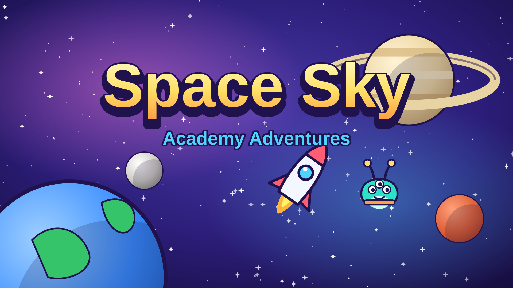

# Space Sky



**Space Sky** is a space exploration adventure for kids aged 6–10. Players join the **Space Sky Academy** as a young cadet, build and upgrade their own rocket, fly through the solar system, land on planets and moons, solve gentle puzzles, meet friendly aliens and learn real space facts. The story runs through five chapters and ends with a trip through a wormhole to the made-up world of **Zephyra**, where the cadet helps relight the Star Beacon.

- About 5–6 hours of play: 27 story missions, 16 side missions, races, daily challenges, 40 badges, 34 stickers and a 50-page Space Codex.
- No ads, purchases, tracking, chat, external links or network requests. Everything (art, music, sound) is generated in code.
- One self-contained file: `dist/index.html` (about 1.1 MB) that works offline, when double-clicked, or inside a sandboxed iframe.

## How to play

1. Press **Play**, pick an empty slot and **make your astronaut** (name, suit, helmet, face, Easy or Normal).
2. At the **Academy hub**, the banner at the top always shows your current mission. Press **Go!** and the game takes you where you need to be.
3. Open the **Star Map**, pick a planet and press **Fly there!** Fly your rocket, collect star-coins and fuel cells, ride comet tails, swoop past planets for slingshots, and follow the yellow arrow.
4. Fly close to a planet or moon and press **Land**. Hold **Thrust** to slow down and touch down on the glowing pad.
5. Explore the surface on foot (or in a rover): collect samples, push crates onto buttons, carry power orbs to machines, match color crystals, talk to friends, and find the hidden sticker on every world.
6. Spend star-coins in the **Hangar** (rocket parts) and the **Shop** (outfits and room decorations). Read the **Space Codex** and check your **Badges & Sticker Book**.

Mistakes are always gentle: bumping a rock costs a little shield and fuel; if you run out, **Tuggy the tow-bot** brings you to the nearest base and you keep everything you collected. There is no game over.

### Controls

| | Touch (tablet/phone) | Keyboard + mouse | Gamepad |
|---|---|---|---|
| Steer / walk | Drag anywhere on the left half of the screen | Arrow keys or W A S D | Left stick or d-pad |
| Boost (flying) / Jump (on foot) / Thrust (landing) | Big orange button | Space | A |
| Action: land, scan, talk, grab, tap crystals | Blue button (it shows what it will do) | E or Enter | X or Y |
| Pause | Pause button | Esc or P | Start |
| Menus | Tap | Mouse, or arrow keys + Enter | D-pad + A, B to go back |

### Settings (always available from the gear button)

Music and sound volume, **Easy / Normal** (changeable any time; Easy gives an autopilot for landings, steering help, auto-scan, more fuel, softer bumps, generous race times and more hints), **Read aloud** (uses the browser's built-in speech; hidden gracefully when unavailable), helpful tips on/off, full screen, a "How to play" card, and **Erase game** (asks for confirmation first). Three save slots let a family share the game.

## For parents and teachers

- **Every real space fact is in one file: [`src/data/facts.ts`](src/data/facts.ts)**, written for early readers. Facts appear in the Codex, in "Did you know?" cards when visiting a place, and when you tap Professor Pip.
- Made-up things (Zephyra, its moons Tibble and Tobble, Zibbo and friends, the Star Beacon, glimmers) are tagged **"Story (made up)"** in the Codex. Wormholes are labeled a **science idea** that has never been found. In-game simplifications (asteroids packed close together, comet tails that speed you up, Neptune's wind pushing your rocket) are called out as "in our game".
- Characters are friendly; "danger" is mild and cartoonish (sleepy space rocks, bouncy "bumblers" that just push you back).

## Building and running

Requires Node 20+.

```bash
npm install
```

```bash
npm run dev
```

```bash
npm run build
```

`npm run build` type-checks and writes **one file**, `dist/index.html`, with all code and styles inlined.

| Command | What it does |
|---|---|
| `npm run dev` | Development server with hot reload |
| `npm run build` | Typecheck + single-file production build |
| `npm test` | Unit tests (Vitest): flight physics, platformer, landing, mission engine, economy, saves and migrations, codex, badges, dailies, races, music, every level's reachability, pacing |
| `npm run test:e2e` | Playwright smoke tests on desktop, tablet and phone viewports (run `npm run build` first) |
| `npm run pacing` | Pacing simulation: estimated minutes per chapter on Easy and Normal |
| `npm run svgs` | Regenerate the site banner and thumbnail in `site-assets/` |

URL flags: `?fps` shows an FPS counter; `?debug` exposes `window.__spacesky` for testing.

## Putting it on Ai Kids Games

1. Run `npm run build`.
2. Copy `dist/index.html` to `public/games/space-sky/index.html` on the site.
3. Copy `site-assets/space-sky-banner.svg` and `site-assets/space-sky-thumb.svg` to `public/games/space-sky/` (banner is 16:9, thumbnail is square).
4. Embed it in an iframe. The game works with the site's sandbox; add the `allow` list so full screen, gamepads and sound work:

```html
<iframe src="/games/space-sky/index.html" title="Space Sky"
  sandbox="allow-scripts allow-pointer-lock allow-same-origin"
  allow="fullscreen; gamepad; autoplay"
  style="width:100%;aspect-ratio:16/9;border:0"></iframe>
```

Notes: saves use `localStorage` (needs `allow-same-origin`; if storage is blocked the game still runs and says progress won't be kept). Read-aloud uses `speechSynthesis` and does nothing if the browser has no voices. The Gamepad API needs the `gamepad` permission in `allow` when the game is served from another origin.

### Registry entry for `games.ts`

```ts
{
  slug: 'space-sky',
  title: 'Space Sky',
  description: 'Build your own rocket, explore the solar system and beyond, meet friendly aliens and learn real space facts!',
  categories: ['Adventure', 'Explore', 'Learning'],
  ageGuidance: 'Ages 6–10',
  contentNotes: 'Friendly aliens, real space facts, no scary content',
  controls: ['touch', 'keyboard + mouse', 'gamepad'],
  devices: ['tablet', 'phone', 'computer'],
  playTime: 'About 5–6 hours',
  path: '/games/space-sky/index.html',
  banner: '/games/space-sky/space-sky-banner.svg',
  thumbnail: '/games/space-sky/space-sky-thumb.svg',
},
```

## How the code is organized

- `src/app/` — game shell (Pixi app, fixed 60 Hz loop with interpolated rendering, scene switching, resize/DPR/safe areas), session and save wiring.
- `src/systems/` — pure game logic with no rendering (unit tested): flight physics, sector generator, landing, platformer, level parser and reachability checker, mission engine, economy, codex, badges, daily challenges, races, saves and migrations, pacing model.
- `src/data/` — all content as typed data: planets (`bodies.ts`), facts, codex, missions (`missions/chapter1-5.ts`), dialogue, characters, rocket parts, shop, badges, stickers, races, tips, themes, levels (`levels/*.ts`).
- `src/scenes/` — screens (title, slots, creator, hub, board, lounge, hangar, shop, codex, badges, star map, flight, landing, explore, cutscene, credits, completion).
- `src/gfx/` — procedural art (Canvas2D vector drawing baked into texture atlases), particles, starfield.
- `src/audio/` — Web Audio synthesizer for sound effects and a procedural music composer/sequencer.
- `src/ui/` — DOM UI: buttons, HUD, dialogue with read-aloud, modals, settings, tips, toasts.

## Adding content

**A fact** — add a line to `src/data/facts.ts` under the right subject (a Codex id). Keep it short and simple. Tests check that every fact belongs to a Codex entry.

**A planet or moon** — add a `BodyDef` to `BODIES` in `src/data/bodies.ts` (look, flight radius, position in its system, gravity, `landable`, `areas`), add it to its system's `bodies`, add a Codex entry in `src/data/codex.ts` and facts in `facts.ts`. A new star-system goes in `SYSTEMS` with a Star Map position and chapter. The planet's art is generated from its `look`.

**An exploration area** — create `src/data/levels/<id>.ts` exporting a `LevelDef` (ASCII map + entity table; see the legend in `src/data/levelTypes.ts` and the example `moon.ts`), list the id in the body's `areas`, and add a hidden sticker for it in `src/data/stickers.ts`. Levels are picked up automatically. Check it with:

```bash
LEVEL=my_level npx vitest run tests/unit/levels.test.ts
```

The checker verifies every sample, NPC, machine and goal is reachable on Normal, every door can open, and you can always walk back to the rocket.

**A mission** — add a `MissionDef` to a chapter file in `src/data/missions/` (objectives like `near`, `land`, `collect`, `scan`, `talk`, `solve`, `reach`, `gates`, `race`, `haul`, `deliver`...) and its briefing/done lines to `src/data/dialogueStory.ts`. Mission items in levels use `when: { mission: '<id>' }` so they only appear during the mission. If a mission needs custom behavior, it can usually be expressed with an objective type; otherwise add one case to `MissionEngine.match`. Tests check every id a mission references and play through the whole campaign to prove nothing can get stuck.

**A rocket part, outfit or decoration** — add it to `src/data/parts.ts` or `src/data/shop.ts`; the drawing style comes from its `style` key in `src/gfx/art/rocket.ts` / `rooms.ts`.
