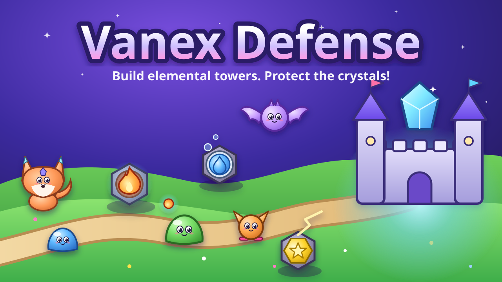

# Vanex Defense



A bright, kid-friendly (ages 7+) **elemental tower defense** game for phones, tablets and computers.
The cheeky Grumblewumps want to borrow the shiny crystals of Vanex! Build towers, shape the creatures' path
into a long, wiggly maze, unlock six elements, and mix them into fifteen combo towers.

- 12 hand-made maps in 4 worlds (Sunny Meadow, Dune Desert, Frosty Peaks, Crystal Caves), 40 waves each
- Easy / Normal / Hard, 1–3 stars per map, Endless mode, 28 badges, a Creature & Tower Book
- Interactive tutorial with Pip the crystal fox
- 100% original: every picture is drawn by code and every sound is synthesized — no asset files, no fonts,
  no ads, no tracking, no network requests
- Ships as **one self-contained `dist/index.html`**

---

## How to play

1. **Pick an element.** You get an Element Crystal at the start and more at waves 5, 10, 15, 20 and 25.
2. **Build towers** from the tower bar. Arrow Posts and Pop Cannons are always available; each element
   unlocks its own tower, and any two elements unlock a **combo tower**.
3. **Make a maze.** On open maps, creatures walk *around* towers. Use towers to make their path long and
   wiggly — the arrows on the ground show the path. You can never fully block it (Pip will tell you
   “That would block the path!”).
4. **Press GO.** Waves come by themselves after a short break. Press **Next** early for bonus coins.
5. **Upgrade** towers (up to level 4) and **sell** them for 75% of what you spent.
6. **Save coins:** every cleared wave pays a small bonus on the coins you saved.

**The element wheel** — strong hits do 1.6× damage, weak hits 0.6×:

| | beats | because |
|---|---|---|
| 💧 Water | 🔥 Fire | Water puts out fire |
| 🔥 Fire | 🍃 Nature | Fire burns leaves |
| 🍃 Nature | 💧 Water | Plants drink water |
| ⭐ Light | 🌙 Shadow | Light chases away shadows |
| 🌙 Shadow | ⬢ Earth | Shadows sneak through rock cracks |
| ⬢ Earth | ⭐ Light | Rocks block the light |

Every element has its own **colour and shape**, so the game is colour-blind friendly. Creatures can be
fast, armored, flying (they ignore your maze!), healers, splitters or wrapped in an element bubble that only
the right element can pop. A boss arrives every 10 waves.

**Stars:** keep 80% of your lives for ★★★, 40% for ★★. Stars open new worlds.

## Controls

| Action | Touch | Mouse | Keyboard |
|---|---|---|---|
| Choose a tower | tap a card in the tower bar (tap **Build** first on small screens) | click a card | `1`–`9`, `0` |
| Build | tap a square, then **✓** (or tap the square again) | click a square | — |
| Select / upgrade / sell | tap a tower → **Upgrade** / **Sell** | click a tower | `U` upgrade, `S` sell, `T` targeting |
| Learn about something | press and hold a tower, creature or card | right-click / hold | — |
| Move / zoom the map | drag / pinch | drag / mouse wheel | — |
| Next wave | **GO** / **Next** | same | `N` or `Enter` |
| Speed 1x / 2x / 3x | speed button | same | `F` |
| Pause | ❚❚ | same | `Space`, `P`, `Esc` |
| Pick an element | **Pick an element!** | same | `E` |

The game pauses itself when the tab is hidden, the window loses focus or the device rotates.

## Build & run

Requires Node 20+ (developed on Node 24).

```bash
npm install
```

```bash
npm run dev          # local dev server (http://localhost:5173)
```

```bash
npm run build        # typecheck + single-file build → dist/index.html
```

```bash
npm test             # Vitest: unit tests + headless balance simulation (≈15 s)
```

```bash
npm run e2e          # build + Playwright on desktop, phone (landscape + portrait), tablet, sandboxed iframe
```

```bash
npm run sim          # autoplay bot plays every map on every difficulty (add -- --casual for a "younger player")
```

```bash
npm run perf         # boot time + frame-time benchmark on CPU-throttled phone / tablet profiles
```

`dist/index.html` works when double-clicked (file://), on any static host, or inside a sandboxed iframe.

**Handy URL flags:** `?map=w2m1&diff=hard` (jump into a map), `?map=w1m1&endless`, `?seed=42` (replay a run),
`?stress=300` (performance stress test with an FPS meter — also works in the production build, so you can try
it on a real phone), `?quality=low|medium|high|auto`. Dev server only: `?editor=1` (map editor),
`?gallery=1` (all baked sprites).

## Putting it on Ai Kids Games

1. `npm run build`
2. Copy `dist/index.html` → `public/games/vanex-defense/index.html`
3. Copy `marketing/banner-16x9.svg` → `public/games/vanex-defense/banner.svg` and
   `marketing/thumbnail-square.svg` → `public/games/vanex-defense/thumbnail.svg`
4. Embed it like this (add `allow="fullscreen"` so the Full screen button works; the button hides itself if
   fullscreen isn't allowed):

```html
<iframe
  src="/games/vanex-defense/index.html"
  sandbox="allow-scripts allow-pointer-lock allow-same-origin"
  allow="fullscreen; autoplay"
  style="width:100%;aspect-ratio:16/9;border:0"
  title="Vanex Defense"
></iframe>
```

5. Ready-to-paste entry for `games.ts` (adjust key names to match your `Game` type if they differ):

```ts
{
  slug: 'vanex-defense',
  title: 'Vanex Defense',
  description:
    'Build elemental towers, mix them into combo towers and make a twisty maze to keep the cheeky Grumblewumps away from the crystal castle!',
  path: '/games/vanex-defense/index.html',
  thumbnail: '/games/vanex-defense/thumbnail.svg',
  banner: '/games/vanex-defense/banner.svg',
  categories: ['Strategy', 'Action'],
  ageGuidance: 'Ages 7+',
  contentNotes: 'Cartoon creatures poof into sparkles',
  controls: ['touch', 'mouse', 'keyboard'],
  devices: ['phone', 'tablet', 'computer'],
  estimatedPlayTime: '15–20 minutes per map (2–4 hours for the whole campaign)',
  orientation: 'landscape', // portrait works too; landscape is roomier on phones
},
```

Saves use `localStorage` (key `vanex-defense-save`, versioned with migrations). If storage is blocked the
game still runs and simply forgets progress when the page closes.

## Project structure

```
src/
  core/      seeded RNG (sfc32), pools, math
  data/      ALL content: elements, towers, enemies, waves, maps/, worlds, difficulty, achievements, strings
  sim/       headless game logic (no DOM/Pixi): Game, grid, flowField, spatial hash, entities, events, autoplay bot
  render/    Pixi: Stage, WorldView, Camera, MapPainter, Particles, FloatingText, quality governor, atlas/ (procedural art)
  ui/        DOM HUD + menus (Hud, modals, styles.css)
  app/       App (screens, ticker, quality), GameScreen, flow (navigation), tutorial, achievements, save, stress
  audio/     Web Audio synth: SFX + step-sequencer music
  dev/       dev-only map editor & sprite gallery (tree-shaken from the production build)
tests/unit/  Vitest (pathfinding, combat, economy, waves, saves, maps, achievements, quality, balance/)
tests/e2e/   Playwright smoke + embed tests
scripts/     simulate.ts, perf.mjs, check-dist.mjs, cpuprofile.mjs, shot.mjs, simdebug.ts, simmap.ts, render-svg.mjs
marketing/   banner-16x9.svg, thumbnail-square.svg
```

The simulation runs at a fixed 30 Hz and is completely separate from rendering, so it is unit-tested and
balance-tested headlessly. The renderer interpolates between ticks and turns sim events (poofs, hits, coins)
into particles, text and sound.

## Adding content

### A new map

1. Design it with the editor: `npm run dev`, open `http://localhost:5173/?editor=1`, paint, **Play test**, then
   **Copy ASCII**.
2. Add a `MapDef` to `src/data/maps/worldN.ts`:

```ts
{
  id: 'w2m4', name: 'Dusty Dunes', world: 2, theme: 'desert', style: 'maze',
  story: 'A short line for Pip to say.',
  favoredElements: ['fire', 'earth'], // creature elements that appear more often
  grid: [ /* rows of the legend below */ ],
}
```

Legend: `.` open ground (walk + build) · `o` build spot only · `=` road · `#` rock · `T` tree/cactus/pine/crystal
· `~` water · `B` bush · `S` spawn · `C` castle (2×2). Keep rows the same width.

3. `npm test` validates every map (castle, reachable spawns, room to build) and **proves it is winnable** on all
   difficulties with the autoplay bot. `npm run sim -- w2m4` shows details.

### A new tower

Add an entry to `TOWERS` in `src/data/towers.ts` — stats for 4 levels via `makeLevels`, a `behavior`
(`bullet`, `chain`, `beam`, `pulse`, `mortar`) and a `look` (silhouette + colours for the procedural painter).
Abilities are data: `splash`, `slow`, `burnDps`, `poisonDps`/`poisonSpread`, `stunChance`, `armorBreak`,
`pushback`, `zoneDps`, `auraRate`, `auraCoins`, `beamRamp`, `shots`, `chain`, `critChance`… If you need a
brand-new attack style, add one behaviour function in `src/sim/Game.ts` (`updateTowers`) and, if it needs a new
silhouette, one case in `src/render/atlas/drawTowers.ts`. Combo towers are found automatically from their two
`elements`. Tests check every tower can hit creatures.

### A new creature

Add it to `ENEMIES` in `src/data/enemies.ts` (health, speed, armor, coins, and optional `flying`, `heal`,
`split`, `shielded`, `shiftElement`…) and use it in `src/data/waves.ts`. Its sprite comes from one of the
`look` painters in `src/render/atlas/drawEnemies.ts`.

## Performance

Measured with `npm run perf` (`?stress=300`: every tower type, 300 creatures, ~440 projectiles in flight,
~1,400 particles) on the production build in headless Chromium with CPU throttling. See
`perf-results/perf.json` after a run.

| Profile | FPS | p95 frame | frames > 20 ms | boot to title |
|---|---|---|---|---|
| Phone, 4× CPU throttle (≈ mid-range Android) | 60 | 16.7 ms | 0% | 0.7 s |
| Phone, 6× CPU throttle (≈ low-end) | ~50 (Auto quality lowers resolution) | 33 ms | 19% | 0.7 s |
| Tablet, 2× CPU throttle | 60 | 16.7 ms | 0% | 0.3 s |
| Desktop | 60 | 16.7 ms | 0% | 0.2 s |
| Phone, *software* GPU (worst case), Auto quality | ~47 | 33 ms | 23% | 0.9 s |

How: fixed-timestep sim, Pixi render groups, sprites baked once into texture atlases, `ParticleContainer`
particles, pooled everything (no allocations in the frame loop), spatial hash targeting, pathfinding only when
towers change, a 60 FPS cap (also on 120 Hz screens), a stopped renderer in menus, and an FPS governor that
lowers resolution, then particles/glow, on slow devices. Low / Medium / High / Auto are also in Settings.

> Throttled desktop Chromium approximates but does not equal a real phone, especially for the GPU — please
> try `index.html?stress=300` on the actual target devices.

## Continuous integration

GitHub Actions: `ci.yml` checks every push and pull request on Ubuntu (typecheck, unit tests + balance sims, build,
dist checks, all Playwright tests); `selfhosted-mac.yml` runs the same plus the real-GPU benchmark on your own Mac,
by hand, for private repositories only. Setup, including putting the project on GitHub: [docs/CI.md](docs/CI.md).

## Testing on real devices

- **Settings → Device → Test performance** runs a 15-second battle (every tower, 300 constructs) with the player's
  own quality setting and shows average fps, the slowest 1 %, the longest frame, quality tier, renderer and screen.
  "Copy results" puts a plain-text summary on the clipboard.
- **Playtest mode:** open the game once with `?playtest=1` (e.g. `index.html?playtest=1`); it stays on for that
  device until "Stop recording" (or `?playtest=0`). Each match (won, lost or abandoned) records map, difficulty,
  waves, lives, lives lost per wave, towers, specializations, abilities, game speed, pauses, frame rate, quality
  tier and screen size — in `localStorage` key `vanex-defense-playtest`, capped at ~60 KB (oldest runs drop off).
  **Nothing personal is recorded, and nothing is ever sent anywhere.** The title screen's "Playtest · N runs"
  button shows the data: *Download JSON* (standalone page) or copy the text (always works, also inside the site's
  iframe), *Delete recorded runs*, *Stop recording*.
- **Analyse:** put the exported `.json` files in a folder and run `npm run analyze-playtests -- <folder>`. It prints
  win rates, where losses cluster, lives lost per wave, speed use and frame rate per map/difficulty and device,
  replays the same maps with the good and casual bots, and lists tuning **suggestions** — it never changes any
  file. Apply a suggestion in `src/data/tuning.ts`, then run `npm run sim` and `npm test`.
- If the GPU context is lost (driver reset, memory pressure), the match pauses with "Graphics paused" and continues
  after one tap when graphics return; if they never do, a Reload button appears (progress is saved).

## Kid-safety & accessibility

No ads, purchases, accounts, links, tracking or network requests. Gentle, short text; creatures “poof” into
sparkles and coins. Colour + shape for every element, 48 px+ touch targets, safe-area aware layout, separate music
and sound volumes, optional screen shake and damage numbers.

Settings → Accessibility: **text size** (100 / 115 / 130 %), **high contrast**, and **reduced motion** (defaults to
the device's setting; turns off shake, wobble and hit flashes and softens big bursts). Settings → Keyboard:
**remappable keys** (conflicts swap; Esc, Space and Enter always work). **Flash safety** is always on: nothing on
screen flashes more than 3 times a second (WCAG 2.3.1) — enforced in code and measured on real rendered frames by
`tests/e2e/flash.spec.ts`.

## Languages

English (source, `src/i18n/en.ts`) and Filipino (`src/i18n/fil.ts`). Settings → Language defaults to the device
language (`fil`/`tl` → Filipino, anything else → English) and can be changed at any time; the choice is saved.
Dev builds also offer a pseudo-locale (accented, ~40 % longer) for layout testing; `?lang=en|fil|pseudo` forces
a language. `npx playwright test tests/e2e/i18n.spec.ts` checks every menu, modal and the battle HUD in all three
on desktop and phones for clipped, cut-off, covered or untranslated text.

### Translations needing review

| Language | Strings | Status |
|---|---|---|
| Filipino (`fil`) | all 949 | **Needs native review** — machine-assisted first draft (`FIL_REVIEW_STATUS = 'needs-native-review'`). Players see a short note under Settings → Language while this is set. |

Notes for the reviewer (open `src/i18n/fil.ts`; keys and `{placeholders}` must stay as in `en.ts`, `npm test` checks):
- Proper nouns stay in English on purpose: tower, construct, hero, ability, specialization, world, map and
  research names, PIP, Vanex, Archon Null, the Shardbound, and the Map Workshop name word lists.
- Glossary used: tore (tower), konstruk (construct), alon (wave), ginto (gold), buhay (lives), Kuta (Citadel),
  core ng elemento, panangga (elemental ward), kalasag (shield), harang (barrier), bayani (hero), kakayahan
  (ability), pananaliksik (research), tsapa (badge), landas (specialization path), Kuwento / Normal / Mahirap /
  Eksperto (difficulties). "Rift", "boss", "upgrade", "combo", "DPS", "Intel" are kept as gamer Taglish.
- Register: UI and tips use informal *mo*; some PIP briefings to the Komandante use polite *ninyo/inyo* — please
  pick one voice for PIP.
- Worth a second look: `badge.king.name` (pun on "null and void"), `boss.*` phase names, `hero.*.role`,
  `trait.disabler` ("Pampatigil"), `map.w6m3.story` ("alingawngaw"), the longer button labels
  (`pause.restart`, `daily.play`, `ability.cancel`, `settings.q.medium`, `title.research`).
- When done, set `FIL_REVIEW_STATUS` to `'reviewed'` (removes the in-game note).

## Credits

Game design, code, art and music: all original, generated in code for this project.
Built with [PixiJS](https://pixijs.com), Vite, TypeScript, Vitest and Playwright.
