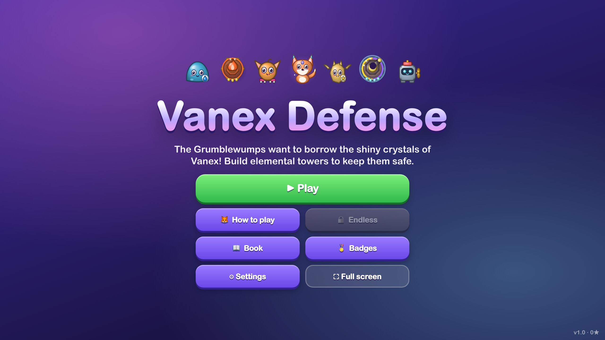
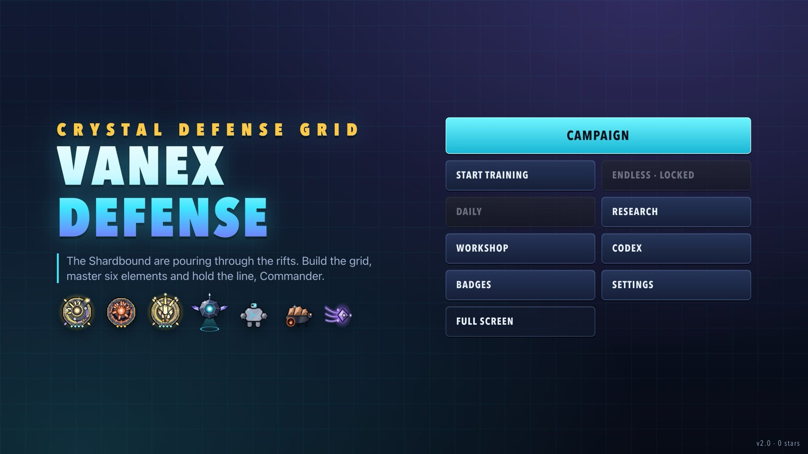
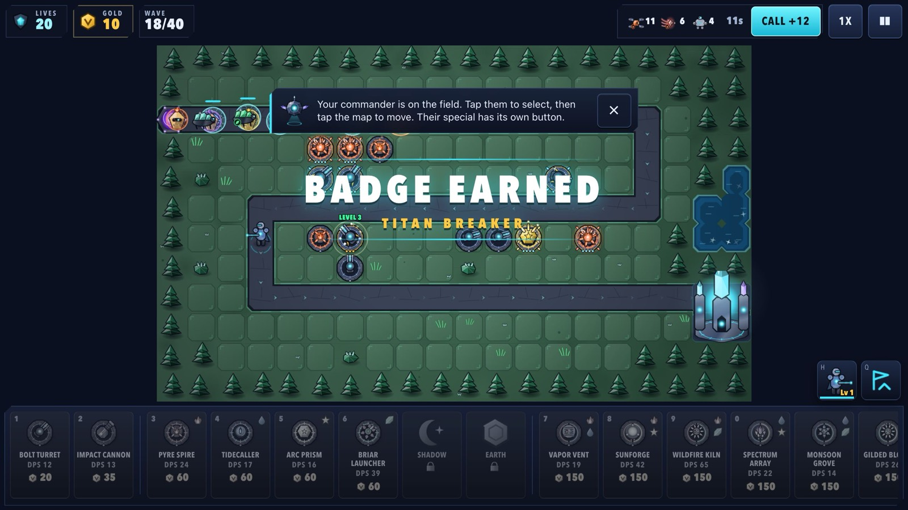
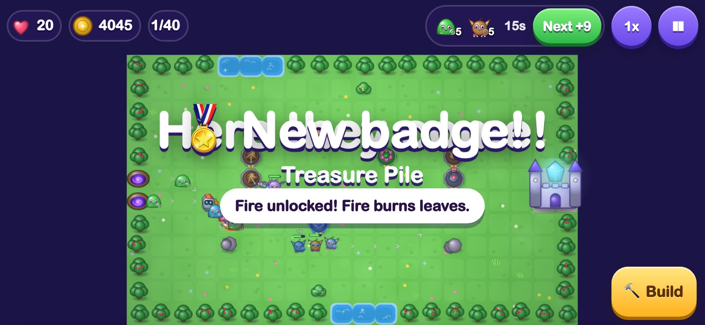
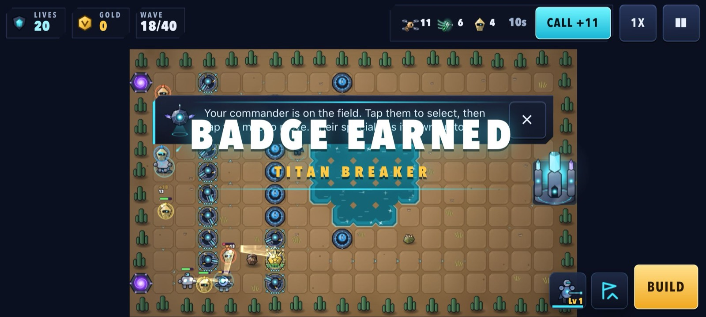
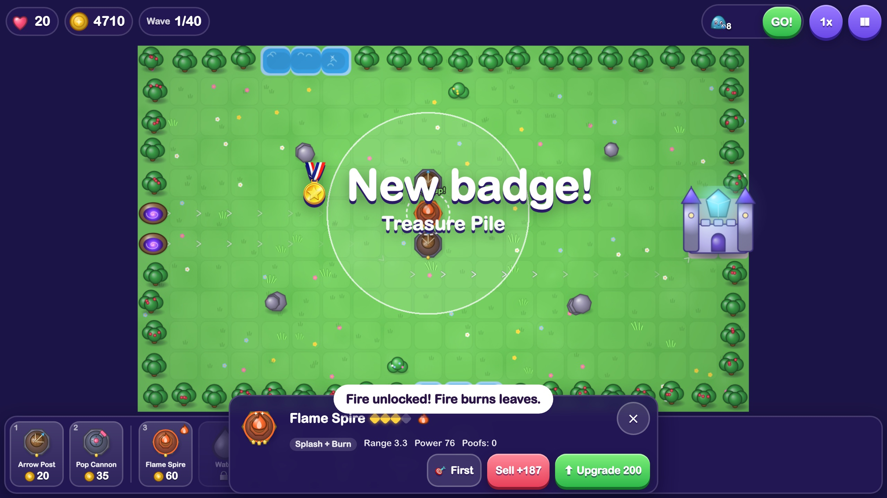
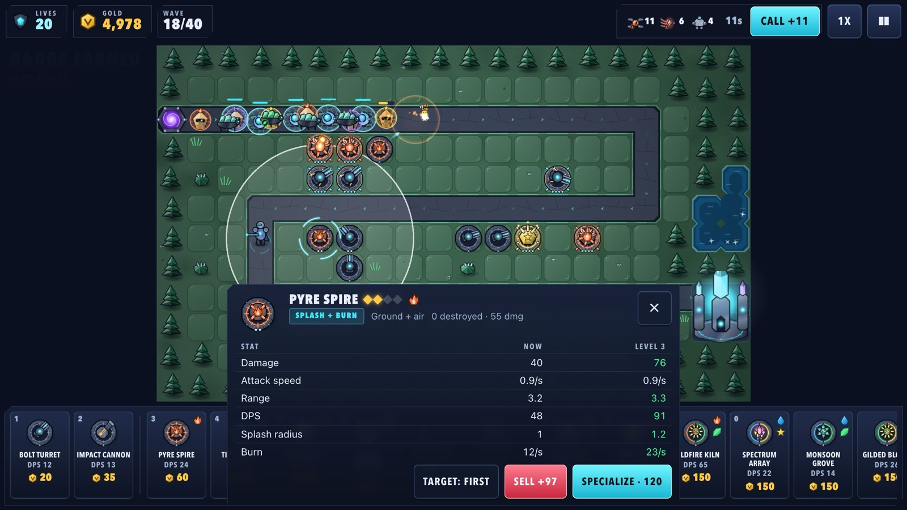
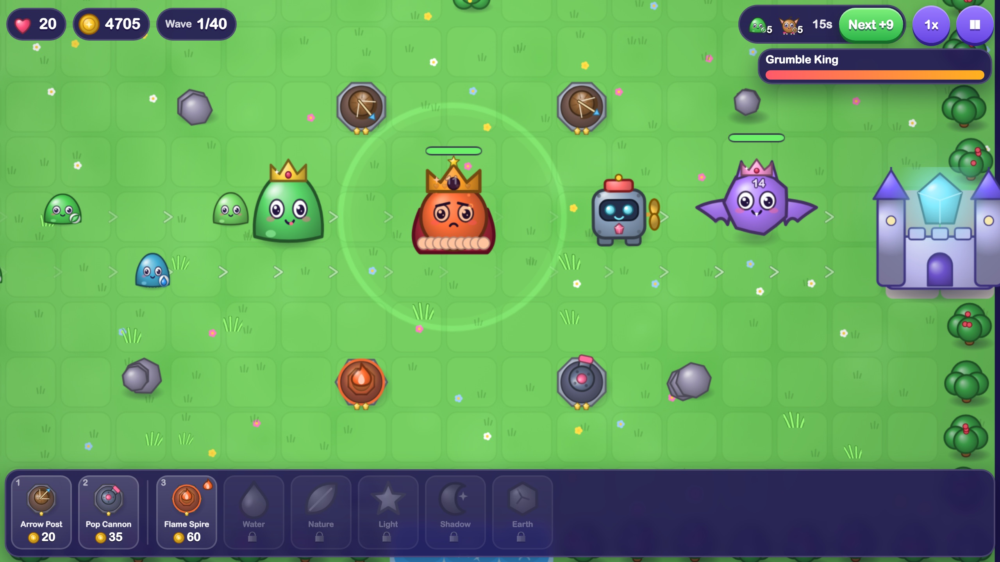
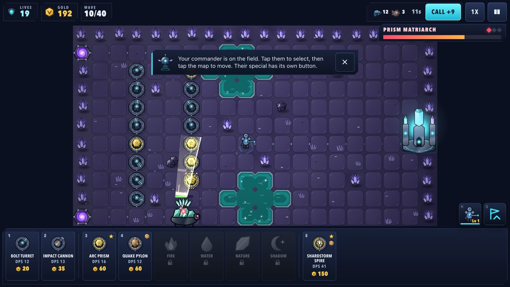

# Vanex Defense v2 — final report

Branch **`vanex-upgrade`** (16 commits on top of `main`). `main` still holds v1 (ages 7+) and nothing has been
merged. Date: 2026-10-11.

## What changed

| Step / phase | Commit | Summary |
|---|---|---|
| Baseline | `5b16301` | "before" screenshots, a real v3 save fixture |
| Step 1 | `f6014fe` | Crystal-tech style slice (approved) |
| 2 | `47b283a` | one tuning file for every balance number, i18n core, save v4 + migration |
| 3 | `ca1d6b9` | full restyle and rewrite for ages 10–14 (PIP reinvented as a tactical AI) |
| 4 | `e7182a8` | 42 specializations, after-match report, wave intel |
| 5 | `05d110a` | shields, barriers, stealth, tunnellers, jammers, regenerators, element wards; multi-phase bosses |
| 6 | `245bc50` | 4 commander heroes, 3 abilities |
| 7 | `dd0b06d` | research, Story/Normal/Hard/Expert, challenge medals, daily challenge, endless mutators |
| 8 | `8495424` | worlds 5–6: gates, drawbridges, sky lane, twin citadels, shifting ground |
| 9 | `aef609d` | Map Workshop with share codes |
| 10 | `58ebab8` | adaptive music per world + boss themes, new SFX and stingers, mixing pass, master limiter |
| 11 | `fc70d98` | Filipino, language picker, overflow checks |
| 12 | `3dad2df` | text size, high contrast, reduced motion, remappable keys, flash safety |
| 13 | `88154fc` | Test performance, playtest recording + analyzer, GPU context loss |
| 14 | `be8ee80` | CI workflows + GitHub setup guide |
| 15 | (this commit) | bots with hero/abilities/research, balance + medal reports, perf, visual review fixes, README, marketing art |

Invariants kept: save key `vanex-defense-save` (v1 progress migrates, tested with a real v3 save), new keys only
with the `vanex-defense-` prefix, worst-case storage far under 200 KB, one `dist/index.html` that runs from
file:// and in a sandboxed iframe with zero network requests, procedural art, synthesized audio.

## Before / after

| | Before (v1) | After (v2) |
|---|---|---|
| Title |  |  |
| Map |  |  |
| HUD (phone) |  |  |
| Tower panel |  |  |
| Boss |  |  |

All review shots (every world, both boss types, specialization chooser, phone panels, menus, Filipino settings):
[`docs/screenshots/after/`](../screenshots/after/) — regenerate with `node scripts/review-shots.mjs`.

Visual review fixes made in this phase: "badge earned" / phase banners no longer cover an open tower panel (they
shrink into the top-left corner), one-time tips step aside for the tower panel on short phone screens.

## Bot balance (per map, difficulty and challenge)

**Summary:** the good bot wins **all 18 sectors on Story, Normal and Hard** without using a hero, abilities or
research (enforced by `npm test`); the casual bot gets **3★ on every Story sector**. **Expert** is meant for
veterans: 12/18 without help, 15/18 with the starter kit, **18/18 once research is done**. Every **challenge medal
is earnable on every sector** with research (90/90); with only the starter kit, 78/90 — Pure Element is the one
that really asks for research (9/18 without it).

### Campaign

| Map | Story | Normal | Hard | Casual bot, Story |
|---|---|---|---|---|
| w1m1 Breach Point | ✅ 30/30 | ✅ 20/20 | ✅ 10/10 | ✅ 30/30 ★★★ |
| w1m2 Switchback Ridge | ✅ 30/30 | ✅ 20/20 | ✅ 10/10 | ✅ 30/30 ★★★ |
| w1m3 Twin Rifts | ✅ 30/30 | ✅ 20/20 | ✅ 6/10 | ✅ 30/30 ★★★ |
| w2m1 Cinder Canyon | ✅ 30/30 | ✅ 20/20 | ✅ 10/10 | ✅ 30/30 ★★★ |
| w2m2 Mirage Basin | ✅ 30/30 | ✅ 20/20 | ✅ 10/10 | ✅ 30/30 ★★★ |
| w2m3 Forge Road | ✅ 30/30 | ✅ 20/20 | ✅ 10/10 | ✅ 30/30 ★★★ |
| w3m1 Whiteout Slope | ✅ 30/30 | ✅ 20/20 | ✅ 9/10 | ✅ 30/30 ★★★ |
| w3m2 Relay Spiral | ✅ 30/30 | ✅ 15/20 | ✅ 6/10 | ✅ 30/30 ★★★ |
| w3m3 Glacier Gate | ✅ 30/30 | ✅ 20/20 | ✅ 10/10 | ✅ 30/30 ★★★ |
| w4m1 Lantern Shaft | ✅ 30/30 | ✅ 20/20 | ✅ 10/10 | ✅ 30/30 ★★★ |
| w4m2 Pillar Vault | ✅ 30/30 | ✅ 20/20 | ✅ 10/10 | ✅ 30/30 ★★★ |
| w4m3 Null Core | ✅ 30/30 | ✅ 12/20 | ✅ 1/10 | ✅ 30/30 ★★★ |
| w5m1 Gatefall Causeway | ✅ 30/30 | ✅ 20/20 | ✅ 10/10 | ✅ 30/30 ★★★ |
| w5m2 Drawbridge Foundry | ✅ 30/30 | ✅ 20/20 | ✅ 10/10 | ✅ 30/30 ★★★ |
| w5m3 Sky Lane | ✅ 30/30 | ✅ 20/20 | ✅ 10/10 | ✅ 30/30 ★★★ |
| w6m1 Twin Bastions | ✅ 30/30 | ✅ 20/20 | ✅ 4/10 | ✅ 30/30 ★★★ |
| w6m2 Shifting Ground | ✅ 30/30 | ✅ 20/20 | ✅ 10/10 | ✅ 30/30 ★★★ |
| w6m3 Rift Core | ✅ 30/30 | ✅ 20/20 | ✅ 10/10 | ✅ 30/30 ★★★ |
| **Wins** | 18/18 | 18/18 | 18/18 | 18/18 |

### Expert (report only)

| Map | Baseline | Starter kit | Full kit |
|---|---|---|---|
| w1m1 Breach Point | ✅ 1/5 | ✅ 4/5 | ✅ 7/7 |
| w1m2 Switchback Ridge | ✅ 5/5 | ✅ 5/5 | ✅ 7/7 |
| w1m3 Twin Rifts | ✅ 1/5 | ✅ 1/5 | ✅ 7/7 |
| w2m1 Cinder Canyon | ✅ 5/5 | ✅ 5/5 | ✅ 7/7 |
| w2m2 Mirage Basin | ❌ w38 | ❌ w39 | ✅ 7/7 |
| w2m3 Forge Road | ✅ 2/5 | ✅ 3/5 | ✅ 7/7 |
| w3m1 Whiteout Slope | ❌ w39 | ✅ 3/5 | ✅ 7/7 |
| w3m2 Relay Spiral | ✅ 1/5 | ✅ 1/5 | ✅ 7/7 |
| w3m3 Glacier Gate | ✅ 3/5 | ✅ 5/5 | ✅ 7/7 |
| w4m1 Lantern Shaft | ✅ 5/5 | ✅ 5/5 | ✅ 7/7 |
| w4m2 Pillar Vault | ❌ w11 | ✅ 3/5 | ✅ 7/7 |
| w4m3 Null Core | ❌ w9 | ❌ w11 | ✅ 1/7 |
| w5m1 Gatefall Causeway | ✅ 5/5 | ✅ 5/5 | ✅ 7/7 |
| w5m2 Drawbridge Foundry | ✅ 2/5 | ✅ 5/5 | ✅ 7/7 |
| w5m3 Sky Lane | ❌ w31 | ✅ 5/5 | ✅ 7/7 |
| w6m1 Twin Bastions | ❌ w11 | ❌ w11 | ✅ 7/7 |
| w6m2 Shifting Ground | ✅ 5/5 | ✅ 5/5 | ✅ 7/7 |
| w6m3 Rift Core | ✅ 2/5 | ✅ 4/5 | ✅ 7/7 |
| **Wins** | 12/18 | 15/18 | 18/18 |

### Challenge medals (Normal, good bot, starter kit)

A failed cell is retried with the full kit (→): every medal must be earnable on every map once research is done.

| Map | Iron | Pure | Budget | Nocombo | Speed |
|---|---|---|---|---|---|
| w1m1 Breach Point | ✅ 1/1 | ❌ w40 → ✅ 26/26 | ✅ 19/20 | ✅ 20/20 | ✅ 20/20 |
| w1m2 Switchback Ridge | ✅ 1/1 | ✅ 12/20 | ✅ 20/20 | ✅ 20/20 | ✅ 20/20 |
| w1m3 Twin Rifts | ✅ 1/1 | ❌ w38 → ✅ 26/26 | ✅ 8/20 | ✅ 20/20 | ✅ 20/20 |
| w2m1 Cinder Canyon | ✅ 1/1 | ❌ w37 → ✅ 26/26 | ✅ 20/20 | ✅ 20/20 | ✅ 13/20 |
| w2m2 Mirage Basin | ✅ 1/1 | ❌ w38 → ✅ 26/26 | ✅ 16/20 | ✅ 20/20 | ❌ w40 → ✅ 26/26 |
| w2m3 Forge Road | ✅ 1/1 | ❌ w39 → ✅ 26/26 | ✅ 19/20 | ✅ 20/20 | ✅ 20/20 |
| w3m1 Whiteout Slope | ✅ 1/1 | ❌ w34 → ✅ 26/26 | ✅ 20/20 | ✅ 20/20 | ✅ 16/20 |
| w3m2 Relay Spiral | ❌ w30 → ✅ 1/1 | ✅ 17/20 | ✅ 15/20 | ✅ 20/20 | ✅ 16/20 |
| w3m3 Glacier Gate | ✅ 1/1 | ❌ w38 → ✅ 26/26 | ✅ 20/20 | ✅ 20/20 | ✅ 20/20 |
| w4m1 Lantern Shaft | ✅ 1/1 | ✅ 20/20 | ✅ 20/20 | ✅ 20/20 | ✅ 20/20 |
| w4m2 Pillar Vault | ✅ 1/1 | ✅ 20/20 | ✅ 11/20 | ✅ 20/20 | ✅ 20/20 |
| w4m3 Null Core | ❌ w9 → ✅ 1/1 | ✅ 20/20 | ✅ 9/20 | ✅ 14/20 | ✅ 20/20 |
| w5m1 Gatefall Causeway | ✅ 1/1 | ✅ 20/20 | ✅ 20/20 | ✅ 20/20 | ✅ 11/20 |
| w5m2 Drawbridge Foundry | ✅ 1/1 | ❌ w38 → ✅ 26/26 | ✅ 12/20 | ✅ 20/20 | ✅ 7/20 |
| w5m3 Sky Lane | ✅ 1/1 | ✅ 20/20 | ✅ 20/20 | ✅ 20/20 | ✅ 20/20 |
| w6m1 Twin Bastions | ✅ 1/1 | ✅ 20/20 | ✅ 17/20 | ✅ 20/20 | ✅ 20/20 |
| w6m2 Shifting Ground | ✅ 1/1 | ❌ w39 → ✅ 26/26 | ✅ 20/20 | ✅ 20/20 | ✅ 20/20 |
| w6m3 Rift Core | ✅ 1/1 | ✅ 20/20 | ✅ 20/20 | ✅ 20/20 | ✅ 20/20 |
| **Starter kit** | 16/18 | 9/18 | 18/18 | 18/18 | 17/18 |
| **With research** | 18/18 | 18/18 | 18/18 | 18/18 | 18/18 |

_216+ bot runs in 126 s._

## Performance and size

`npm run perf` — `?stress=300`: every tower type, 300 constructs, ~440 shots, ~1,400 particles, hero special +
meteor/chrono abilities firing. **Caveat:** the machine was heavily loaded by other projects during every
measurement (load average 30–57: a Docker VM and other games' test runs), so absolute numbers are lower bounds.
v1 was measured back-to-back under the same load for comparison.

| Profile | v2 | v1 (same moment) |
|---|---|---|
| Phone, 4× CPU throttle | 54–58 fps · sim 2.2 ms + draw 6.4 ms per frame | 53–57 fps · 1.6 + 5.6 ms |
| Phone, 6× CPU throttle, heaviest map (w6m3) | 36 fps (Auto drops to Low, 0.75× resolution) · 4.5 + 8.8 ms | — |
| Tablet, 2× CPU throttle | 60 fps | — |
| Desktop | 60 fps | — |
| Phone, software GPU (worst case) | 17.9 fps (Low: 8.7) | 14.3 fps (Low: 11.3) |

v2 costs ~1.4 ms more CPU per frame than v1 at 4× throttle (new mechanics, hero, abilities): about 8.6 ms of the
16.7 ms frame budget, and v1 dropped frames just like v2 under the same load. A clean measurement on an idle
machine is still owed — run `npm run perf` on the Mac when it is quiet, or the self-hosted Mac CI workflow (it runs
the benchmark and uploads the results). Texture memory: atlases 48 MB with
mipmaps (29 MB on Low) + ~12 MB terrain ≈ 60 MB, inside the ~64 MB budget.

**Build:** `dist/index.html` **1.11 MB** (334 KB gzip; v1: 827 KB / 247 KB) — budget 2 MB, enforced by
`npm run check:dist`.

**Tests:** 281 unit tests (incl. balance sims for all 18 sectors) and the Playwright suite (smoke, sandboxed
iframe, languages ×3 with overflow checks, 130 % text + high contrast, remapped keys, reduced motion, real-frame
flash audit, playtest export, performance test, GPU context loss) on desktop / phone landscape / phone portrait /
tablet — 68 runs, all passing (also in CI mode).

## Testing on real devices

1. **Settings → Device → Test performance** on each device: 15 seconds, shows average fps, slowest 1 %, longest
   frame, quality tier, renderer and screen; "Copy results" for a plain-text summary.
2. **Playtests:** open the game once with `?playtest=1`. Every match is recorded on that device (no personal
   data, never sent). Title screen → "Playtest · N runs" → *Download JSON* (or copy the text when embedded).
   Collect the files in a folder and run `npm run analyze-playtests -- <folder>`: it compares players with the
   bots and prints tuning **suggestions** only — nothing is applied.
3. `index.html?stress=300` shows a live FPS meter (works in the production build).

## Translations needing review

**Filipino (`src/i18n/fil.ts`): all 1,010 strings are a machine-assisted first draft and need a native speaker's
review** (`FIL_REVIEW_STATUS = 'needs-native-review'`; players see a small note in Settings → Language until it
is set to `'reviewed'`). Notes for the reviewer are in the README ("Translations needing review"): glossary,
proper nouns kept in English, PIP's mixed *mo* / *ninyo* register, and a short list of strings worth a second look.

## Known issues and open items

- **Not on GitHub yet.** CI workflows are ready; `docs/CI.md` has the exact steps (private repo with `gh`, push,
  enable Actions, optional self-hosted Mac runner). Nothing has been pushed.
- **Performance numbers are from a busy machine** (see above) — re-run `npm run perf` on an idle Mac before
  release; 6× low-end with 300 constructs runs at ~36 fps (the quality governor lowers resolution).
- **Portrait phones:** the board is small in portrait; the game suggests rotating (landscape recommended).
- **Tight spots:** w4m3 "Null Core" on Hard is won by the no-hero baseline bot with 1/10 lives (10/10 with the
  starter kit); Expert loses 3 sectors without research; Pure Element needs research on 9 sectors.
- **Filipino** is unreviewed (above).
- **Storage on this Mac** was 99 % full during the work (3–5 GB free) and caused one transient test failure;
  worth freeing space before heavy test runs.

## To approve and ship

1. Review the branch (`git log main..vanex-upgrade`), play `npm run dev`, look at the screenshots above.
2. When happy: merge into `main` (e.g. `git checkout main && git merge --no-ff vanex-upgrade`), `npm run build`,
   and follow README → "Putting it on Ai Kids Games" (new banner/thumbnail, recapture previews, registry entry
   with "Ages 10–14").
