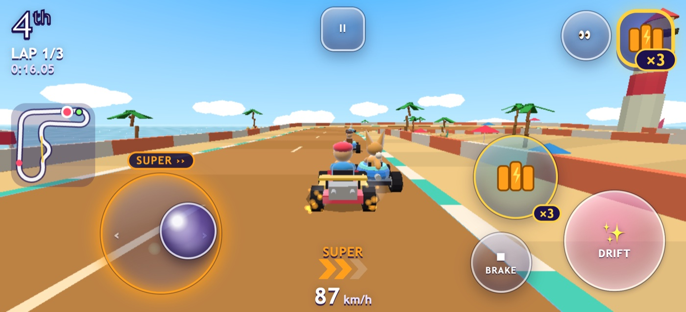
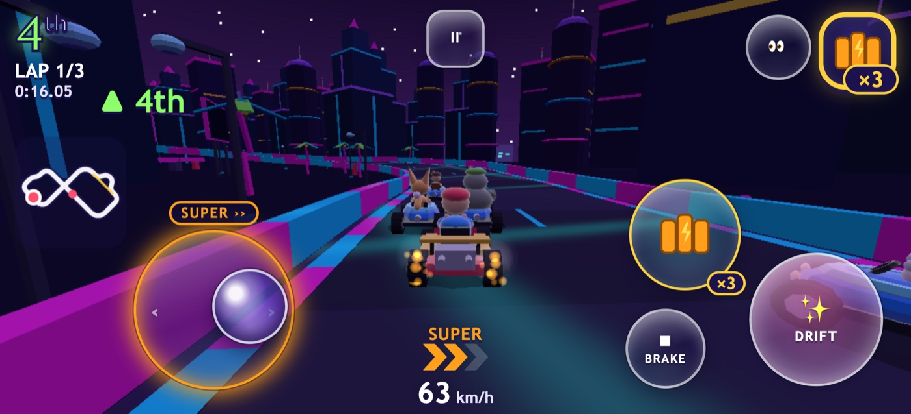
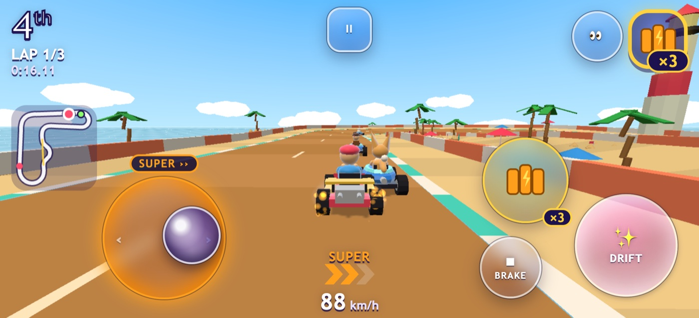
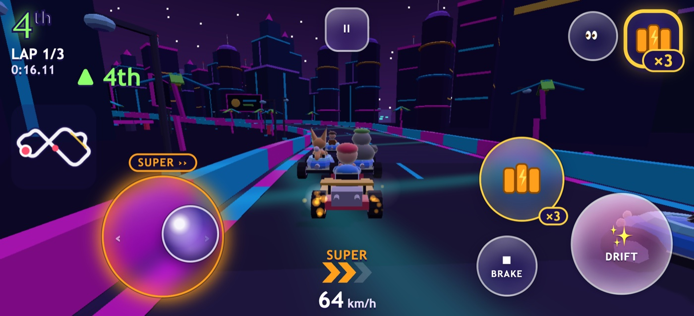
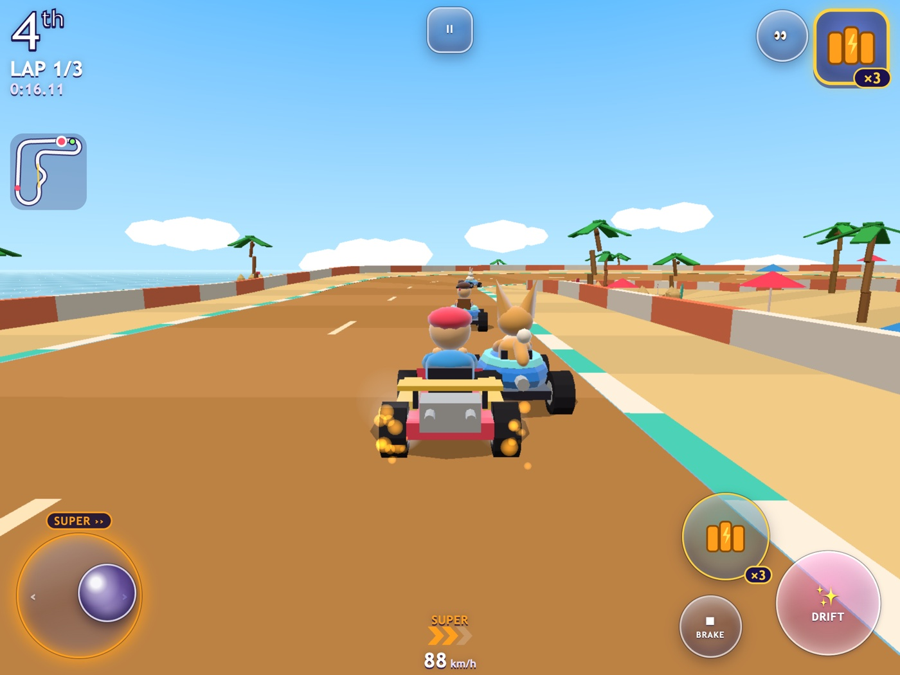
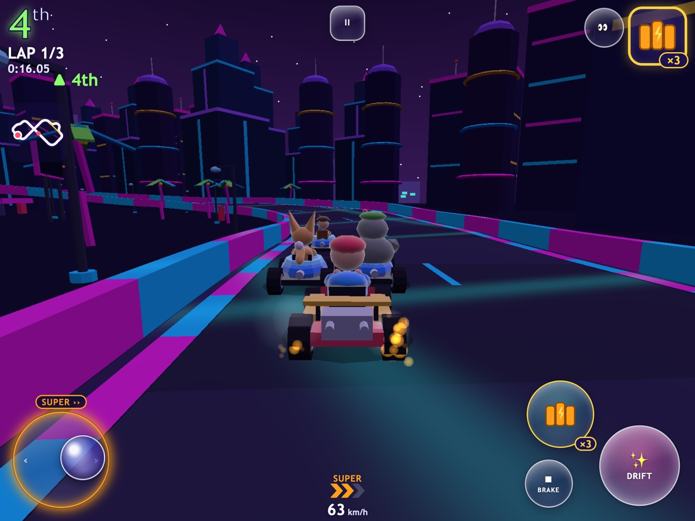
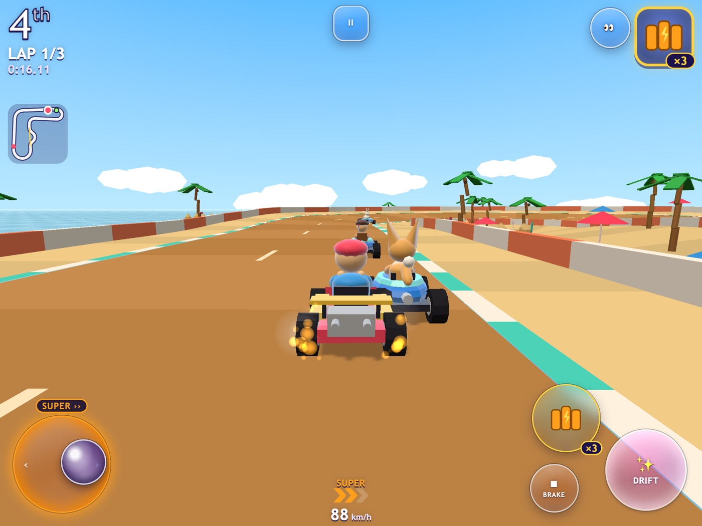
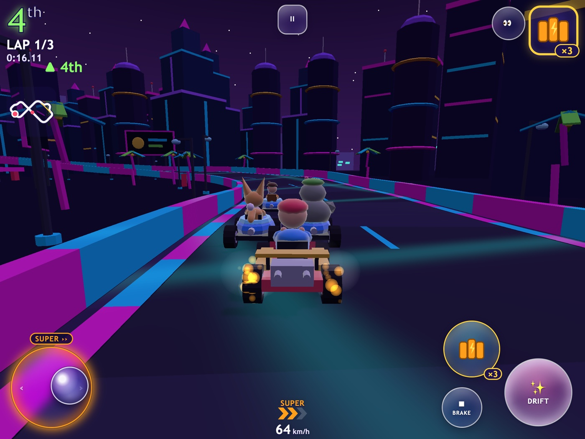
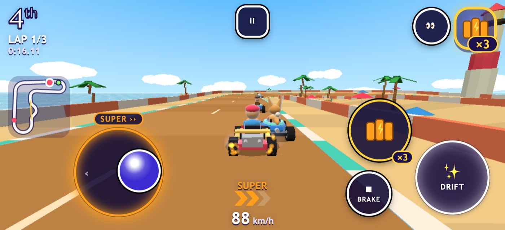
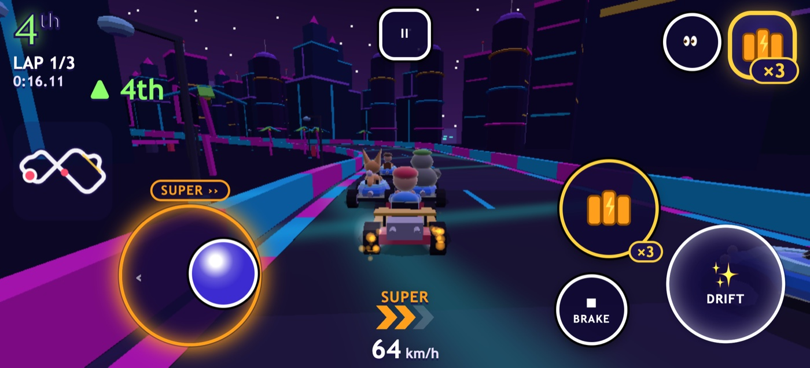

# Glass touch controller: report

Branch `calex-upgrade` (not merged into `main`). Design: [design.md](design.md). The glass controller is the
default on touch devices. Buttons and Tilt still work, and keyboard, gamepad and tilt behave exactly as before.

## Screenshots

Live races with the thumb pushing right on the stick, a tier-2 drift ("SUPER ››" on the ring), a Triple Turbo held
(×3) and DRIFT pressed. **Fake glass** is what every tier uses; **real blur** appears only on High, and only while it
costs no frames.

| | Seashell Boardwalk (bright) | Neon Nightway (dark) |
|---|---|---|
| Phone · fake glass (Medium) |  |  |
| Phone · real blur (High) |  |  |
| Tablet · fake glass (Medium) |  |  |
| Tablet · real blur (High) |  |  |
| Phone · high contrast |  |  |

Every track (20) at Low, Medium and High on a phone was captured with `scripts/captureTouch.mjs` and reviewed as
contact sheets (`sim-report/touch/`). The review found three things, all fixed:
- the capture overrode the race state, so the ring and item weren't shown (a capture-script bug);
- with real blur, button labels disappeared under the frost layer (fixed with `position: relative`);
- the ITEM glass didn't show how many uses were left, so it now has a "×3" badge like the HUD.

## FPS: no controls vs fake glass vs real blur

Benchmark race (Neon Nightway, 8 karts) on the **throttled** profiles: 4× CPU slowdown; phone 844×390 at DPR 3,
tablet 1024×768 at DPR 2. Cells: average FPS / 1 % low FPS. "Real blur" is **forced on** for this measurement at
every tier; in the game it is only ever used on High.

| Profile | Tier | No controls | Fake glass | Real blur | Fake − none | Blur − none |
|---|---|---|---|---|---|---|
| phone | auto (→ medium) | 60 / 59.5 | 60 / 59.5 | 59.9 / 48.9 | 0.0 | -0.1 |
| phone | low | 60 / 59.5 | 60 / 59.5 | 60 / 59.5 | 0.0 | 0.0 |
| phone | medium | 60 / 59.5 | 60 / 59.5 | 60 / 59.5 | 0.0 | 0.0 |
| phone | high | 59.5 / 33.6 | 59.6 / 35.8 | 59.5 / 33.6 | 0.1 | 0.0 |
| tablet | auto (→ medium) | 60 / 59.5 | 60 / 59.5 | 59.9 / 53.6 | 0.0 | -0.1 |
| tablet | low | 60 / 59.5 | 60 / 59.5 | 60 / 59.5 | 0.0 | 0.0 |
| tablet | medium | 60 / 59.5 | 60 / 59.5 | 59.9 / 48.8 | 0.0 | -0.1 |
| tablet | high | 59.6 / 35.8 | 59.5 / 31.6 | 59.5 / 31.7 | -0.1 | -0.1 |

How to read it: averages are capped at 60 by vsync, so the 1 % low (the slowest frames) is where a cost shows.
Each cell is the median of 3 runs of 15 s.

- **At Auto (the DoD): no frame-rate loss.** Both profiles settle on Medium, which uses fake glass: 60 / 59.5 with
  or without the controls, on the phone and on the tablet.
- **Fake glass costs nothing measurable** on any profile or tier. Differences at High are within run-to-run noise;
  High already stutters on these throttled profiles without any controls.
- **Real blur costs frames when forced on below High:** the 1 % low falls to 49 (phone Auto/Medium), 54 (tablet Auto)
  and 49 (tablet Medium) from 59.5. That's why it's used only on High. On High its cost is lost in the noise here,
  but an earlier single-run sweep saw the phone's 1 % low fall from 31 to 18 with blur. So at runtime blur also
  switches itself off (with a 300 ms crossfade) the moment frames slow or jank, and stays off for that visit.
- Re-run: `npx vite preview --port 4173 &` then `npm run bench-controls -- --runs 3` (writes `sim-report/touch-perf.md`).

## What was built

| Step | |
|---|---|
| Joystick | Analog steering with an 8 % dead zone, a gentle curve (exponent 1.5) and full lock at 90 % of the knob's travel; only the sideways axis steers. Floating by default (appears where the thumb lands on its side; never off screen); Fixed in Settings. Every finger belongs to the control it touched (`PointerRouter`), so the stick keeps tracking its thumb anywhere on screen, and other fingers can't steal it. Tested with all three steering-assist levels in the simulator (`tests/sim/touchAssist.test.ts`): every race finishes, assist still catches falls, and the stick is no slower than the old pads. |
| Buttons | DRIFT, ITEM (held item's icon + ×N inside the glass), BRAKE, GO (only with auto-accelerate off, and pulsing during the countdown for rocket starts), look back, pause. Pressed = sinks 2 px, brightens, inner glow, ripple. |
| Drift feedback | The stick's ring glows in the spark-tier colour **and** shows a badge with chevrons and a word: MINI › / SUPER ›› / ULTRA ›››. |
| Haptics | Android only (`navigator.vibrate`), at most 40 ms: drift tier up, item hit, big landing. iOS has no web vibration, so nothing happens there. Switch: Settings → Rumble & vibration. |
| Customisation | Settings → 📱 Touch: steering mode, floating/fixed, size, opacity, left-handed (also moves the touch minimap to the right), high contrast, vibration, and a live preview over a bright and a dark backdrop. **Edit layout**: drag to move, yellow corner to resize (0.8–1.4×), HUD shown as no-go zones; nothing may leave the safe area, cover the HUD or overlap; saved per orientation in `calexcart.settings`; Reset to default. |
| Tablet portrait | Tablets may race upright with their own default layout; phones keep the "turn sideways" screen. |
| Performance | Fake glass (gradients, no blur) on every tier. Real blur is a separate frost layer that crossfades in and out over 300 ms, so the quality governor can drop a tier without a pop, and it is removed entirely once faded. It appears only on High at full render scale, and steps aside for the rest of the visit if frames slow (average over 17.6 ms) or jank (more than 2 % of frames over 25 ms in two windows in a row, after a 3 s warm-up). |
| Accessibility | Reduce effects stops the ripple, trail, pulse and glide animations; a high-contrast option; every touch target at least 48 px, even at Small; chevrons and words, labels and ARIA. |
| Playtest | Each touch race records steering mode, floating/fixed, size, hands, contrast, custom layout and glass mode. `npm run analyze-playtests` lists races per steering mode and size. |

## Tests

- **Unit** (`tests/unit/touch.test.ts`, 47 tests):
  - the stick curve;
  - the layout solver: phone, short phone, tablet, tablet portrait and the HUD at 150 %, at every size and both
    hands, with no overlaps, nothing off-screen, nothing on the HUD, and 48 px targets;
  - saved layouts: round trip, mirroring and repairing a corrupted save.
- **Settings migration:** v2 → v3 turns Buttons (the old default) into Joystick and keeps Tilt.
- **Browser** (`tests/e2e/touch.spec.ts`), on phone, tablet and tablet portrait in Chromium and WebKit:
  - analog steering at several stick angles;
  - steering, drift and item at the same time, ending in a real drift and a used item;
  - the floating stick appearing under the thumb, keeping its finger outside its zone, and ignoring a second finger;
  - left-handed play; Buttons and Tilt;
  - 48 px targets at Small, reduced motion and high contrast;
  - Android vibration (and nothing on WebKit);
  - Edit layout: drag, the screen edge, the HUD, overlaps, resize, save, reload and reset;
  - phones upright showing the rotate screen.
- **Real multi-touch:** Chromium uses true multi-touch through the DevTools protocol. Playwright has no multi-touch
  API for WebKit, so there the same finger scripts run as in-page multi-pointer events.
- **Full suite:** all earlier tests still pass. Keyboard, gamepad and tilt are unchanged. The keyboard-only menu
  test now also walks the new Touch tab.

## What still feels off

- **No real phone or tablet yet.** Thumb comfort, the 8 % dead zone and the 1.5 curve feel right in simulation and
  in tests, but deserve a real hands-on session with 10–14 year olds. The playtest log now records the setup to help
  tune it.
- **Blur cost is measured on a desktop-class GPU.** The benchmark slows the CPU 4× but not the GPU, and frosted
  blur is mostly GPU work. Real phones (especially older iPads and mid-range Android) may pay more. The runtime jank
  check is the safety net, but it may switch blur off sooner, or later, than ideal on some devices.
- **WebKit multi-touch is simulated** in the tests (a Playwright limit), so iPhone and iPad multi-finger behaviour
  is only truly confirmed in Chromium.
- **Drift tier-up vibration** is in the code path but isn't checked end to end; the browser test covers the item-hit
  and landing pulses.
- **On very short phones**, a thumb that lands right at the bottom edge gets a stick base pulled up so it stays on
  screen, so the knob starts slightly off-centre vertically. Steering only uses the sideways axis, so it doesn't
  matter in play, but it looks a little odd.
- **The held item shows twice:** in the HUD item box and in the ITEM glass. The brief asked for the glass; the HUD box
  also shows the roulette and is kept for keyboard and gamepad players.
- **Rotating the device while editing the layout** keeps the editor in the orientation it opened in; reopen it after
  turning.
- **On touch phones the HUD tops out at 125 %**, because at 150 % there's no room left for the thumbs.
