# Glass touch controller: design

Approved design for Calex Cart's touch controls: a frosted, translucent analog joystick plus matching buttons for
players aged 10–14 on phones and tablets. The mockups are real races with a CSS prototype layered on top
(`mockups/prototype.mjs`), on Seashell Boardwalk (bright) and Neon Nightway (dark).

| | Bright track | Dark track |
|---|---|---|
| Phone · fake glass (every tier) | 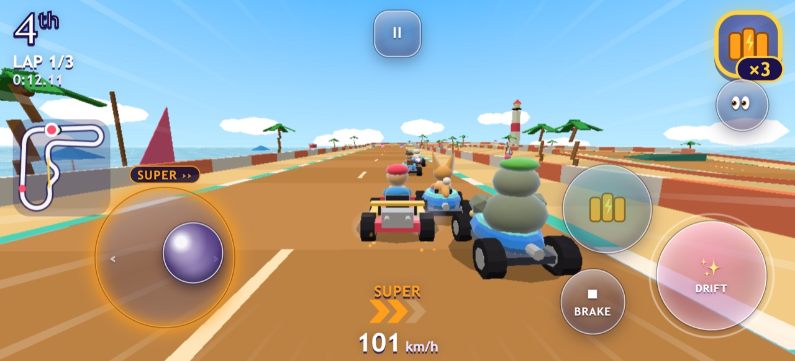 | 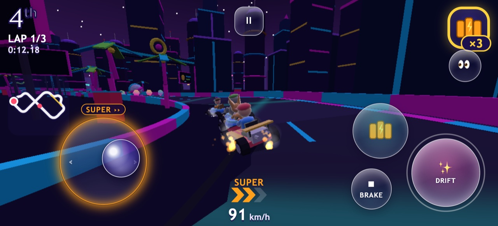 |
| Phone · real blur (High only) | 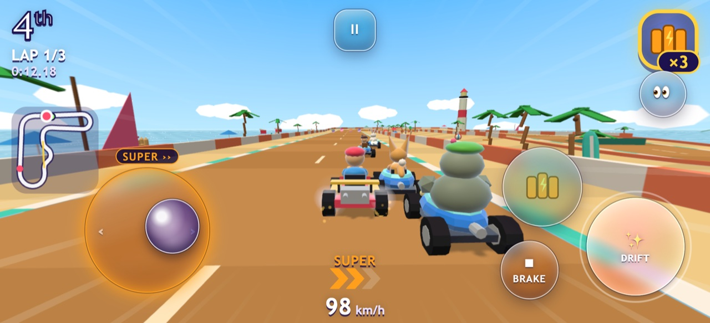 | 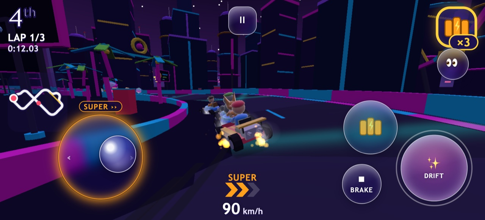 |
| Tablet · fake glass | 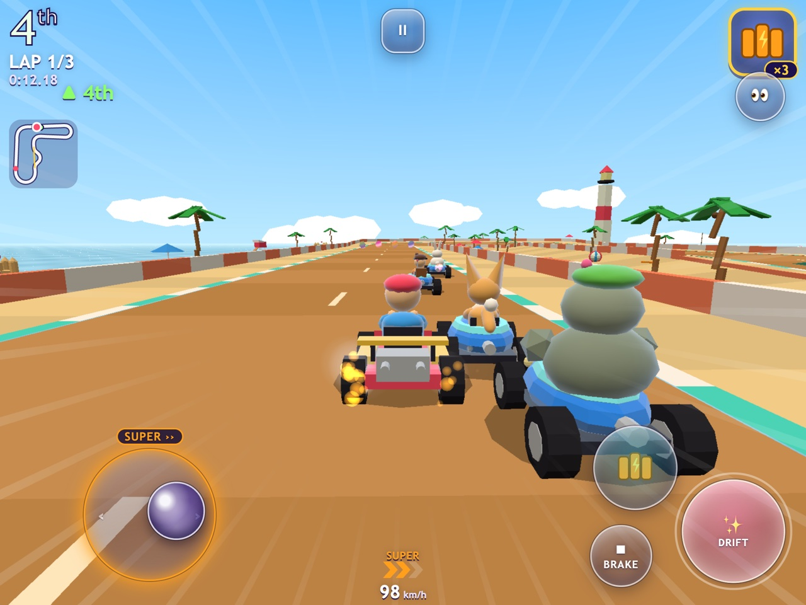 | 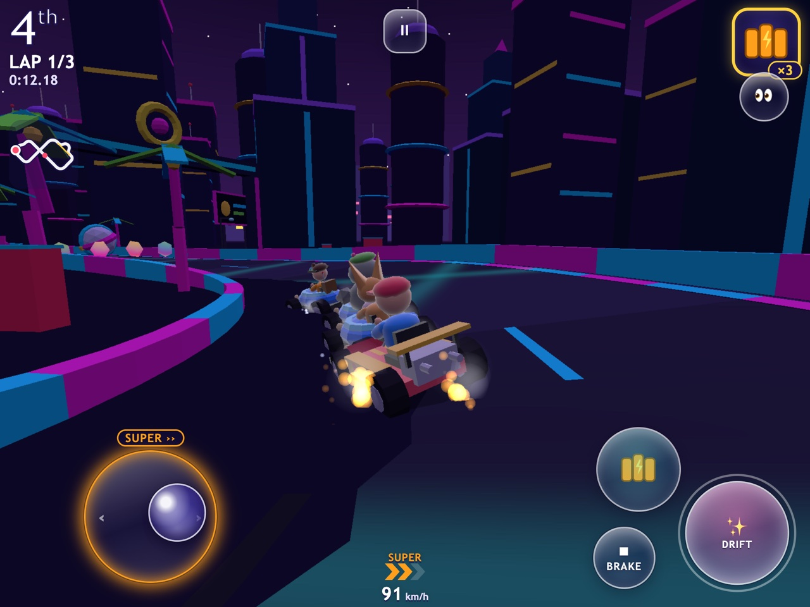 |
| Tablet · real blur | 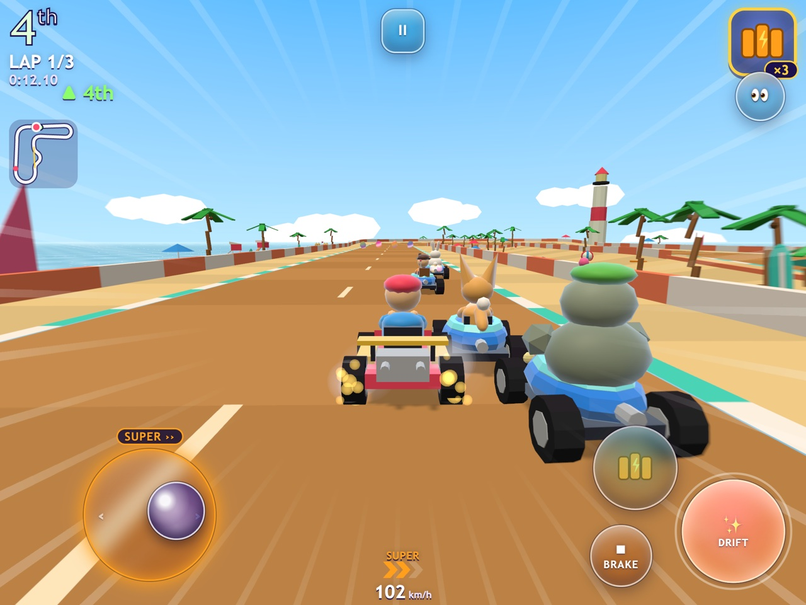 | 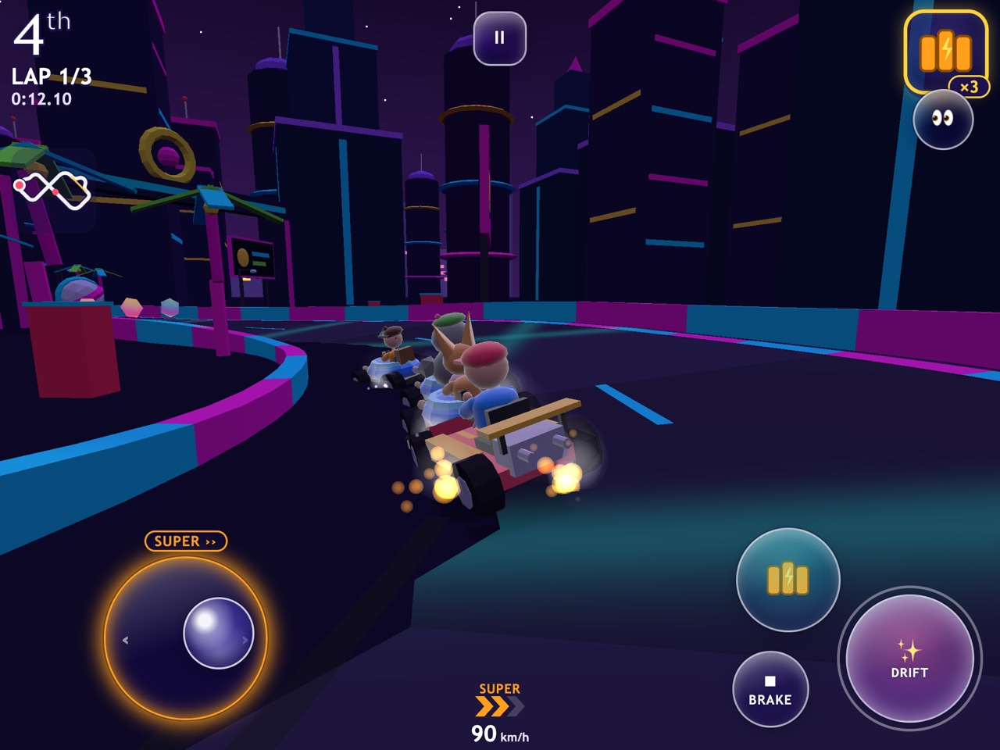 |
| Before (current controls) | 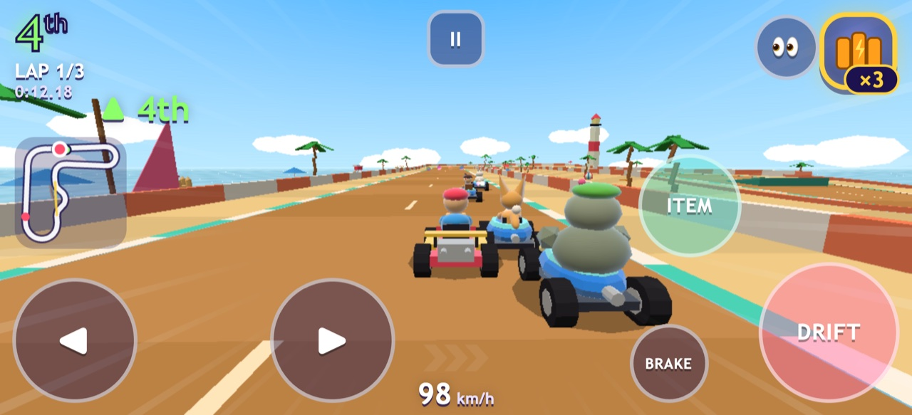 | 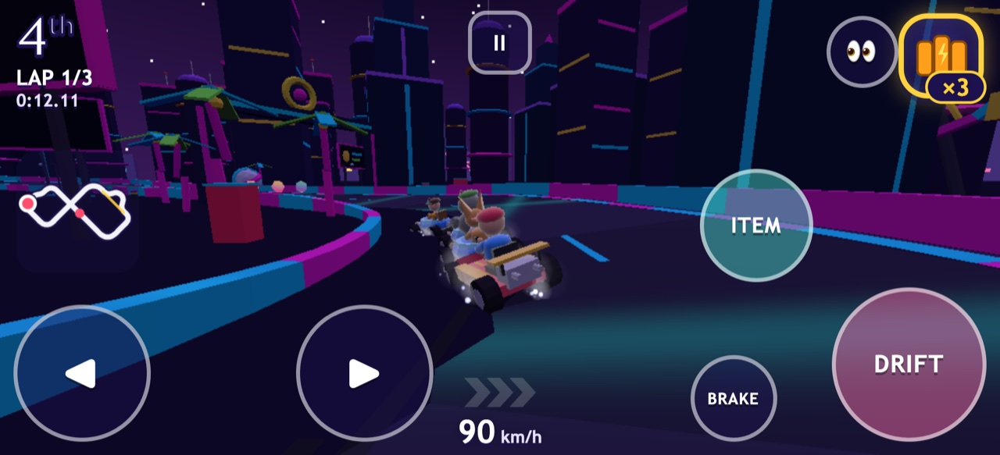 |

Every state, on both backgrounds: 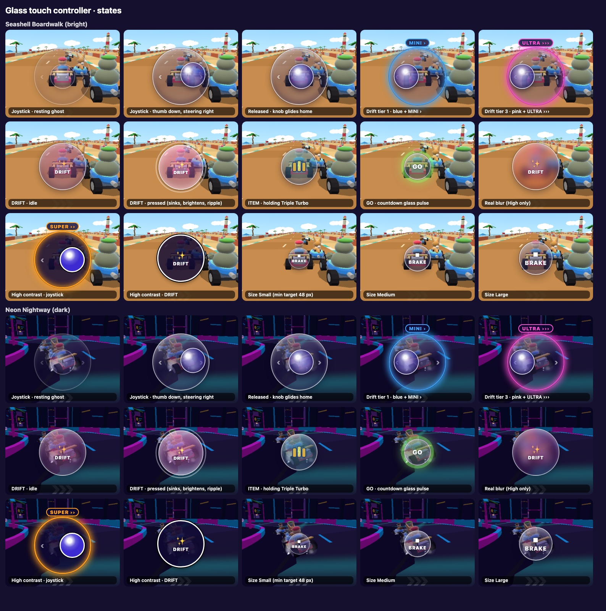

## Shapes
- **Joystick base:** a circle, 132 px on a phone and 150 px on a tablet at Medium size, with faint ‹ › engravings
  that hint "steer left / right".
- **Knob:** a glossy glass bead, 0.44 × the base. Its specular highlight moves opposite to the push direction, so
  the bead looks like it rolls. On release it glides back to centre with a short two-step fading trail.
- **Buttons:**
  - DRIFT is the largest, under the right thumb's resting spot.
  - ITEM sits above-left of DRIFT and shows the held item's icon inside the glass.
  - BRAKE is to the left of DRIFT.
  - GO (only when auto-accelerate is off, and during the countdown for rocket starts) sits above DRIFT.
  - 👀 sits beside the HUD item box.
  - Pause is a rounded square at top centre.

## Glass skin (the same layers on every control)
1. **Frost:**
   - a diagonal sheen band (white 34 % → 0 at 52 %);
   - a soft glow rising from the bottom;
   - a **navy tint (30 %)**, so the glass never disappears against white sand.
2. **Double rim:** a light 2 px inner rim (white 62 %) plus a dark 1 px hairline outside it. The light rim reads on
   night streets and the dark hairline reads on sand.
3. **Inner light:** an inset top highlight and inset bottom shade make the disc look thick and curved. A soft drop
   shadow lifts it off the road.
4. **Colour and words:** each button has its own tint (DRIFT pink, ITEM teal, GO green) plus an icon **and a word**,
   so no control depends on colour.

**Real blur** (High tier only, and only while it costs no frames) uses the same layers with a lighter tint plus
`backdrop-filter: blur(9px) saturate(1.5)`, so the road colour shows through softly. **Fake glass** is used
everywhere else: layered gradients and shadows with no blur. The two look close, and switching between them
crossfades over 300 ms with no pop.

**High contrast** (option): a solid deep-navy fill, a thick white rim and a black outline, with no see-through.

## States
| State | Look |
|---|---|
| Floating stick at rest | 38 % "ghost" at the default spot, so players know where to put their thumb |
| Thumb down / steering | full opacity; base appears where the thumb lands in the left zone; knob follows |
| Pressed button | sinks 2 px, scales to 0.95, brightens, inner glow, soft ripple ring |
| Drift tier 1 / 2 / 3 | stick ring glows blue / orange / pink **and** a badge shows `MINI ›` / `SUPER ››` / `ULTRA ›››` |
| Countdown GO | green glass pulse |
| Reduce effects on | no shimmer, ripple, pulse or trail animation; the same static states |

## Visibility on bright and dark tracks
The navy tint plus the double rim (light inside, dark outside) keep every control readable on the brightest
(Seashell Boardwalk sand) and darkest (Neon Nightway) tracks. The visual review in step 7 re-checks all 20 tracks at
every tier.

## Fixes the mockups showed (applied in the build)
- The default stick spot moves lower and further left, clear of the touch minimap.
- 👀 moves beside the HUD item box (the mockup put it underneath, overlapping on tablets).
