# Calex Cart 0.2: upgrade report

Branch **`calex-upgrade`** (25 commits on top of `main` @ 5ea2ca9, one or more per phase). It has **not been
merged into `main`**; that waits for your approval. All numbers below were measured on 2026-10-11 on an Apple M3 Pro
in headless Chromium (ANGLE Metal) against the built single file, unless a row says otherwise.

## Definition of done

| Requirement | Result |
|---|---|
| All tests pass locally | ✅ Unit + simulation **192 / 192**. Playwright **62 passed, 0 failed** across Chromium + WebKit × desktop / tablet / phone, including file:// and the sandboxed iframe, with no console errors and no network requests |
| All tests pass in CI | ⚠️ `.github/workflows/ci.yml` is ready, but the project has no GitHub remote yet, so it hasn't run on GitHub. It was rehearsed locally with software rendering + test mode (`CI=1 CALEX_TESTMODE=1 CALEX_SWIFTSHADER=1`); the timing issues it found are fixed |
| Saves load with nothing lost | ✅ A real v2 save fixture exported from the old build (`tests/fixtures/save-v2.json`: slot, settings, ghosts) loads with every unlock, trophy, record and ghost (`tests/unit/saveFixture.test.ts`). Migrations: save v2→v3 (Frost Cup for Legend-trophy holders, Driving School field), settings v1→v2 (assist level). Old ghosts are re-encoded to the compact format at startup |
| 60 FPS on the throttled tablet profile at Medium | ✅ 1024×768, DPR 2, 4× CPU slowdown: Neon Nightway 60.0, Jadefall Temple 59.5, Lantern Village 60.0, Avalanche Peak 59.7 fps (p99 16.8 ms) |
| Low lighter than before on the heaviest tracks | ✅ See [Performance](#performance): same race, old vs new build. Triangles −41 % / −58 %, average draw calls −3 % / −11 %, CPU render time equal or lower |
| Build under 2 MB | ✅ **1,213,435 bytes** (was 1,036,991). `npm run build` now fails at 2,000,000 |
| Storage worst case under 1.5 MB | ✅ **1.08 MB**. See [Storage](#storage) |
| Every track passes the validator | ✅ All 20 tracks + 2 practice courses. The 4 Frost tracks also pass in every speed class, normal and mirrored (6 runs each: 8/8 finish, 0 falls) |

## Before / after

Same seed, same moment in the race (14 s), 1280×720. "Before" is `main` @ 5ea2ca9.

| | Before | After |
|---|---|---|
| Seashell Boardwalk · High | 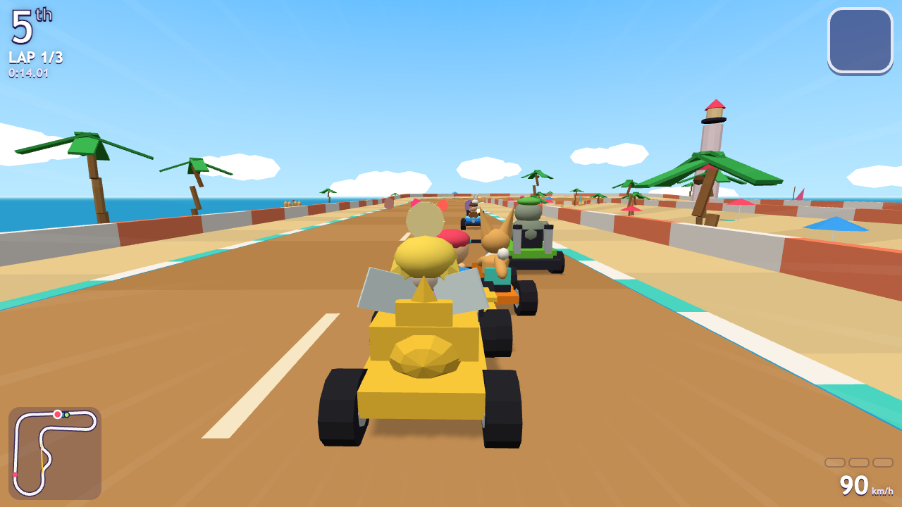 | 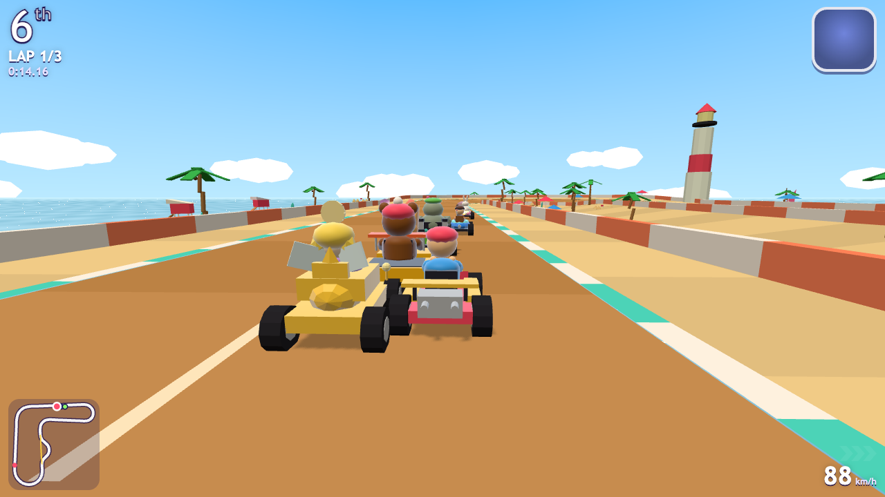 |
| Neon Nightway · High | 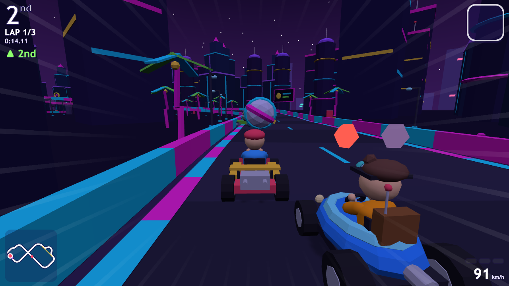 | 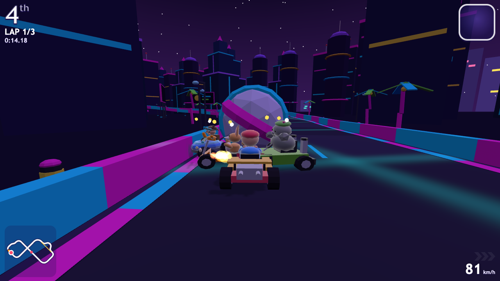 |
| Neon Nightway · Low | 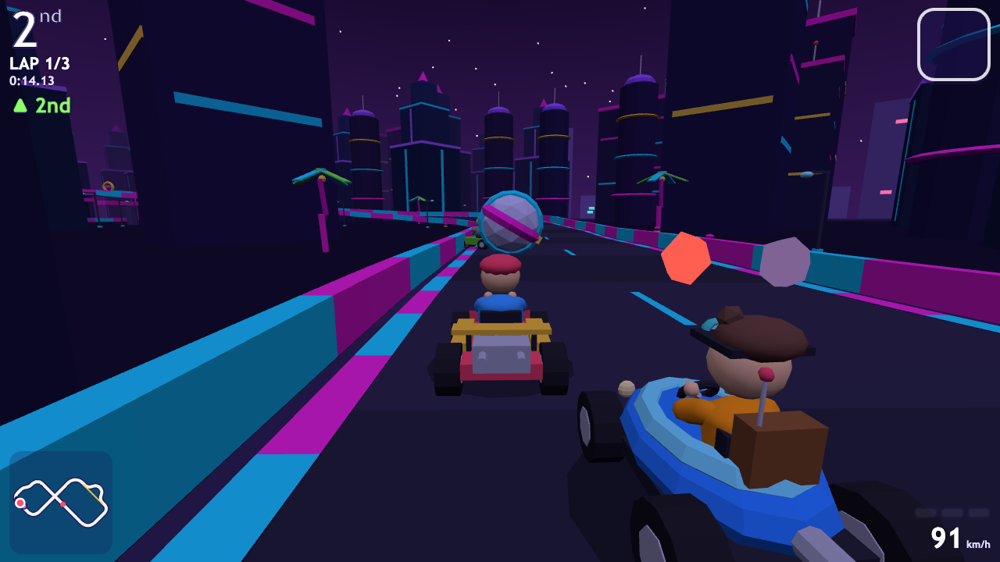 | 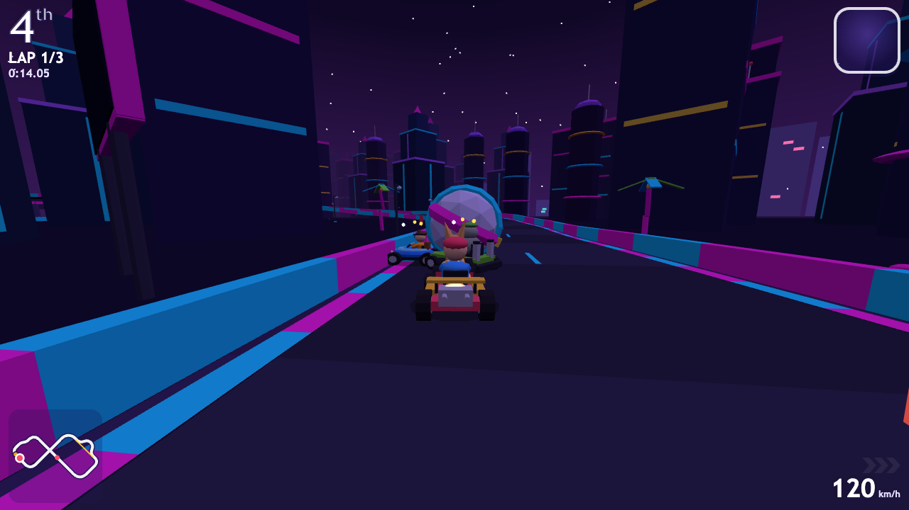 |
| Frostpeak Pass · Medium (now with ice) | 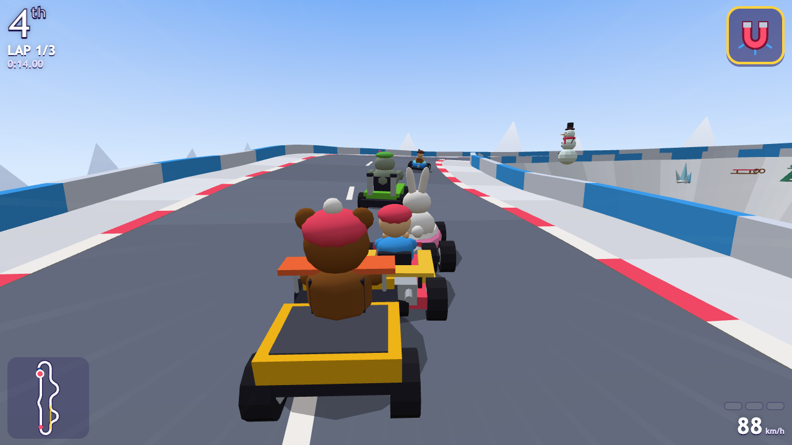 | 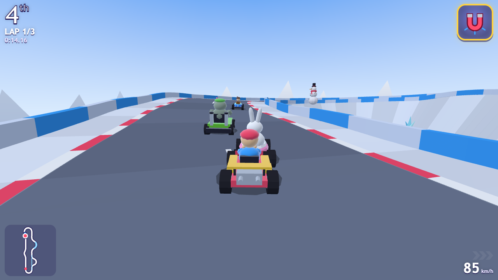 |
| Jadefall Temple · Low | 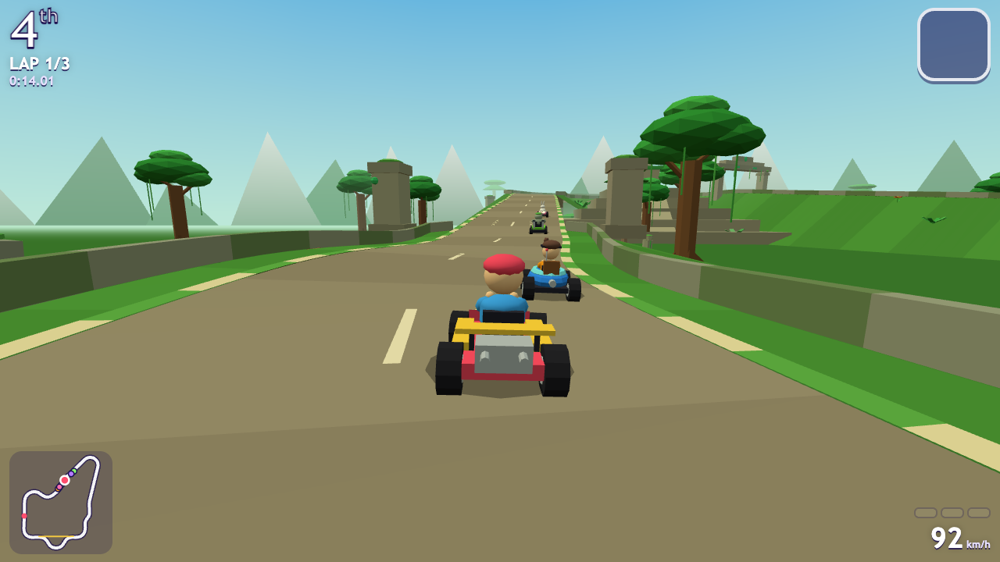 | 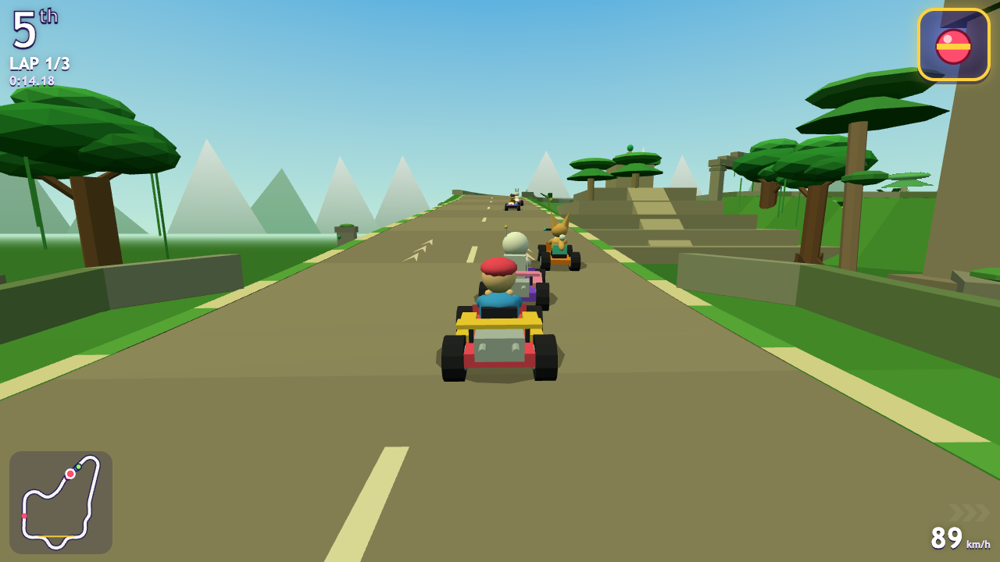 |
| Phone HUD · Medium | 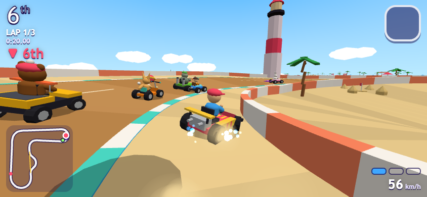 | 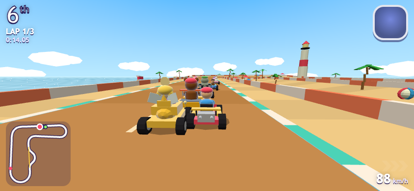 |

All 12 pairs (4 tracks × Low / Medium / High) are in `docs/upgrade/before/` and `docs/upgrade/after/`.
New content: `after/frost/` (Shiver Lake, Crystal Cavern, Lantern Village, Avalanche Peak) and `after/features/`
(150 % HUD with spark chevrons and a word warning, phone touch HUD at 125 %, controls card, Driving School, main menu).
Every track was also captured at all three tiers for review; that review found and fixed three visual bugs (below).

## Balance

Re-run any time with `npm run balance-report` and `npm run sim` (writes `sim-report/`).

**Catch-up** (Pro, 8 racers, 20 tracks × 10 seeds = 200 races per scenario)

| Measure | Before | After | Target |
|---|---|---|---|
| Median gap 1st → 4th, equal skill | — | **2.68 s** | ≤ 4 s |
| Median gap 1st → 8th, equal skill | — | **6.57 s** | ≤ 12 s |
| Strong racer (skill 1.0) wins / top 3 | — | **60 % / 88 %** | ≥ 45 % / ≥ 80 % |
| Weak racer (skill 0.3) wins | — | **1 %** | ≤ 8 % |
| From last on the grid to top 4 | 6 / 16 races | **41 %** | 30–50 % |

**Fairness** (identical AI drivers, items off): weight classes light 0.52 · medium 0.47 · heavy 0.52 (0.50 is even);
the best-to-worst racer spread went from 0.28 to **0.18**. Yuki, the new racer, averages 0.60, in the middle of the pack
(a test now checks every racer added after launch). Speed classes: Rookie 164 s → Pro 125 s (−24 %) → Champion
105 s (−17 %).

**Steering assist** (a simulated beginner with wandering steering, Rookie, all 20 tracks): falls **Off 43 · Light 7 ·
Full 0**; average finish 203 s · 186 s · 180 s. Auto picks Light on touch screens and Off on keyboard or gamepad.

**Staff ghost times** (Time Trial, Pro). Before, the plain Pro AI beat the staff ghost on 9 of 16 tracks. Now
every staff time sits between a near-perfect "strong bot" and the best of five Pro AI runs, aiming at 35 % of that gap
(`npm run calibrate-staff`; `tests/sim/staff.test.ts` enforces it).

| Track | Strong bot | **Staff** | Pro AI (best of 5) |
|---|---|---|---|
| Seashell Boardwalk | 1:49.68 | **1:53.62** | 2:00.55 |
| Rooftop Rally | 1:43.47 | **1:45.42** | 1:49.23 |
| Candy Factory | 1:45.60 | **1:47.27** | 1:50.48 |
| Canyon Run | 1:35.07 | **1:36.53** | 1:39.50 |
| Cinder Summit | 2:19.93 | **2:22.25** | 2:26.60 |
| Spooky Swirl Fair | 1:48.33 | **1:49.90** | 1:53.15 |
| Sunstone Ruins | 1:46.92 | **1:48.25** | 1:51.95 |
| Frostpeak Pass | 1:44.70 | **1:47.72** | 1:53.72 |
| Crater Hop Base | 2:06.88 | **2:09.90** | 2:15.40 |
| Coral Dome Dash | 2:04.13 | **2:05.18** | 2:09.03 |
| Windmill Sky Isles | 1:43.50 | **1:46.20** | 1:52.68 |
| Gearworks Factory | 1:44.90 | **1:49.70** | 1:53.48 |
| Neon Nightway | 2:04.52 | **2:05.77** | 2:08.93 |
| Jadefall Temple | 2:09.60 | **2:10.77** | 2:13.38 |
| Sky Castle Soar | 2:14.93 | **2:19.80** | 2:25.32 |
| Prism Parkway | 2:20.23 | **2:22.75** | 2:27.03 |
| Shiver Lake | 1:54.17 | **1:55.70** | 1:59.02 |
| Crystal Cavern | 1:57.70 | **1:58.07** | 1:58.75 |
| Lantern Village | 1:54.98 | **1:57.93** | 2:04.72 |
| Avalanche Peak | 2:26.55 | **2:28.32** | 2:29.85 |

## Performance

**Benchmark** (`?bench=1`: 30 s, 8 karts on Neon Nightway, the heaviest track; chase camera)

| Profile | Tier | Avg FPS | 1 % low | Avg / max draws | Avg / max triangles | 3D data | JS heap |
|---|---|---|---|---|---|---|---|
| Desktop 1280×720 | Low | 60.0 | 59.5 | 40 / 48 | 51k / 64k | 19.7 MB | 28 MB |
| | Medium | 60.0 | 59.5 | 44 / 53 | 71k / 93k | 25.2 MB | 51 MB |
| | High | 59.9 | 51.1 | 54 / 67 | 90k / 121k | 25.2 MB | 43 MB |
| | Auto → High | 59.8 | 46.7 | 54 / 67 | 90k / 121k | 25.2 MB | 43 MB |
| Tablet 1024×768 DPR 2, 4× CPU | Low | 60.0 | 56.4 | 39 / 47 | 50k / 63k | 19.7 MB | 38 MB |
| | Medium | 59.9 | 48.8 | 43 / 52 | 68k / 90k | 25.2 MB | 43 MB |
| | Auto → Medium | 59.9 | 53.7 | 43 / 52 | 68k / 90k | 25.2 MB | 43 MB |
| Phone 844×390 DPR 3, 4× CPU | Low | 60.0 | 48.8–56.4 ¹ | 41 / 49 | 52k / 66k | 19.7 MB | 36 MB |
| | Medium | 60.0 | 59.5 | 45 / 54 | 73k / 95k | 25.2 MB | 43 MB |
| | Auto → Medium | 59.9 | 51.1 | 45 / 54 | 73k / 95k | 25.2 MB | 43 MB |

¹ Two re-runs; a first run showed one 26 fps hitch (59.2 average), most likely shader compiles under the 4× slowdown.

Memory budget: JS heap < 120 MB and 3D data < 60 MB on the heaviest track. Peak is 51 MB / 25 MB. (Chrome rounds
`performance.memory`, so heap figures repeat.)

**Low, old build vs new, the same race** (seed 7, 8 karts, 15 s; CPU render time with a 4× CPU slowdown, three runs averaged)

| Track | Avg draws | Avg triangles | CPU render / frame | Sim / frame |
|---|---|---|---|---|
| Neon Nightway | 41.0 → **36.3** | 111k → **46k** | 2.79 → **2.91 ms** (same, within noise) | 0.46 → 1.01 ms |
| Jadefall Temple | 38.4 → **36.8** | 72k → **42k** | 2.98 → **1.80 ms** | 0.62 → 0.41 ms |

Low draws far fewer triangles than before and no more draw calls on average. A few busy frames still peak higher,
e.g. Jadefall reaches 49 draws against the old 46. Rendering costs the same CPU time or less. The one CPU increase
is the simulation on Neon Nightway: about +0.5 ms per frame with a 4× CPU slowdown, from the smarter AI (drift
decisions, coin and edge handling). It applies at every quality tier and leaves plenty of headroom.

## Storage

Worst case, measured by `tests/unit/storage.test.ts` → `sim-report/storage.json`: a 4-minute ghost (the longest
kept) on **all 20 tracks in all 3 slots**, plus a full playtest log and settings.

| Part | Bytes |
|---|---|
| 60 ghosts (largest 15.6 KB, compact `G2` format) | 935,586 |
| 3 save slots | 47,952 |
| Playtest log (rolling buffer, oldest races dropped first) | 99,878 |
| Settings | 1,272 |
| **Total** | **1,084,726 (1.08 MB of the 1.5 MB budget)** |

When storage is full, the game frees its own playtest log first. If that's not enough, it shows a friendly message
and keeps playing, and a save is never half-written. Calex Cart only ever reads, writes or removes `calexcart.*` keys.
Tests cover all of this, including another game's keys staying untouched.

## Running the playtest and the benchmark on a real device

Full steps are in README → *Testing on real devices*. In short:

1. `npm run build`, then `npx vite preview --host --port 4173`, then open the printed **Network** address on the
   iPad or phone (same Wi-Fi).
2. **Playtest:** add `?playtest=1`, or tap the Settings title 5 times and turn on *Playtest recording*. A
   "Playtest recording on" badge shows while it's on. Race normally, then Settings → 🧪 Playtest → **Export playtest data**
   (inside the site's iframe this shows a Copy box) or **Clear playtest data**. Put the exports in a folder and run
   `npm run analyze-playtests -- <folder>`: it suggests `src/tuning/balance.ts` changes and never applies them.
3. **Benchmark:** Settings → Graphics → **Test performance (60 s)**, or add `?bench=1&quality=medium`. For memory on
   iOS, use Safari Web Inspector (Mac Safari → Develop → device → Timelines); the benchmark also logs to the console.

## GitHub and CI

Full steps are in README → *Continuous integration*. In short:
`gh repo create calex-cart --private --source . --remote origin`, then `git push -u origin main` and
`git push -u origin calex-upgrade`. CI runs on each push and pull request: typecheck, build and 2 MB check, unit and
sim tests, validator, then Playwright in Chromium and WebKit on Low-quality test mode. Reports and screenshots are
uploaded on failure.
The optional **self-hosted Mac** workflow (`mac-gpu.yml`, real GPU, full quality and benchmark) is for **private
repositories only**. It never runs for pull requests, refuses to start unless the repo is private and the owner
started it, and README explains how to make sure untrusted pull requests can't run code on your machine.

## Ai Kids Games handoff

- Slug **`calex-cart`** and the `calexcart.*` key prefix are unchanged.
- **New storage key:** `calexcart.playtest` (only when playtest mode is on, about 100 KB max). Changed formats in
  existing keys: slots are v3 (Driving School medals), settings are v2 (assist level, reduce effects, rumble, HUD size,
  controls card seen, playtest flag), and ghosts use the compact `G2` format. `calexcart.__probe` is a momentary
  storage check.
- **Build size:** 1,213,435 bytes (about 1.21 MB).
- **Recapture the site previews and cover art.** The Frost Cup, Yuki, new lighting and the new HUD make the old
  screenshots and banner/thumbnail art out of date.
- Updated registry entry:

```ts
{
  slug: 'calex-cart',
  title: 'Calex Cart',
  description: 'Drift, boost and glide through 20 bright tracks, from sunny beaches to a snowy village at night, in an original 3D kart racer. Win Grand Prix trophies in five cups, chase Time Trial ghosts, earn medals in Driving School, pop balloons or grab coins in Battle, or race a friend in split-screen.',
  categories: ['Racing', 'Action'],
  ageGuidance: 'Ages 10–14',
  contentNotes: 'Cartoon kart battles with silly spin-outs',
  controls: ['keyboard', 'gamepad', 'touch'],
  devices: ['computer', 'tablet', 'phone'],
  playTime: 'About 7–8 hours, plus replay',
  path: '/games/calex-cart/index.html',
  banner: '/games/calex-cart/banner.svg',
  thumbnail: '/games/calex-cart/thumbnail.svg',
},
```

## Final verification

| Check | Result |
|---|---|
| `npm run typecheck` | clean |
| `npm run build` (single file + size check) | 1,213,435 bytes, under 2,000,000 |
| `npm test` | 19 files, **192 tests passed** |
| `npm run validate` | All tracks OK (20 + 2 practice courses); Frost tracks additionally in all 6 class/mirror runs |
| `npm run sim` / `npm run balance-report` | every catch-up target met, every staff ghost between strong bot and Pro AI |
| `npx playwright test` (Chromium + WebKit × desktop / tablet / phone) | **62 passed, 0 failed** (34 skips are by design: some tests run once per engine or only on touch / desktop profiles). Includes file://, the sandboxed iframe, keyboard-only / gamepad-only / touch-only menus, context loss, benchmark, replay, Driving School, Coin Rush; no console errors, no network requests |

## Fixed during the final review

- **Blob shadows and exhaust of hidden rivals.** A rival right behind the chase camera is hidden so it doesn't block
  the view, but its shadow (a black disc) and exhaust (orange blobs) still drew at the lens. Both now hide with the
  kart, and particles fade out within 4 m of the camera.
- **Item pods looked like flat hexagons up close.** They're now faceted, lit gems with a glow that keeps them bright on
  night tracks.
- **Shared-material shader churn.** One material was shared by instanced and plain meshes, so three.js re-resolved
  shader programs for about 110 objects every frame. This had been there since v1, and fixing it lowered Low's CPU
  render time.
- **Coin Rush AI.** Racers circled coins, coins could spawn inside obstacles, and karts could get wedged under
  platforms or ramp ends. Now every AI racer collects at least 9 coins per 2-minute match in every arena.
- **Results screen on a landscape iPhone.** Several "Challenge complete" notes pushed the results table over the
  Replay/Rematch buttons, so they couldn't be tapped in WebKit. The table now shrinks and scrolls, and the buttons
  always stay visible (`after/features/results-iphone-webkit.png`).
- **Controls card** no longer overflows a landscape phone.

## Known issues

- **CI hasn't run on GitHub yet** (no remote). It was rehearsed locally with software rendering; the first real run may
  need a timeout tweak because GitHub runners are slower than this Mac.
- **No real-device run.** iPad and iPhone are covered by Playwright's WebKit engine with device profiles, not by real
  hardware. Run the playtest and benchmark steps above on a real iPad and a mid-range Android phone before launch.
- **Occasional first-race hitch.** One phone-profile benchmark run had a single drop to about 26 fps (1 % low), most
  likely shaders compiling under the 4× CPU slowdown; re-runs held 49–56. On slow devices the very first race can
  stutter once while shaders compile.
- **Staff ghost positions vary** from 21 % to 56 % of the strong-bot → Pro AI gap (target 35 %). The calibrator can
  only pick whole runs, so some tracks land a little easy or hard. All are inside the gap.
- **The controls card shows once to existing players** the first time they race on each device, even though they
  already know the controls. It closes with a single tap or key.
- **Instant replays live in memory only.** They're gone after leaving the results screen, by design (no storage cost).
- **The four Frost Cup worktree branches** (`worktree-agent-*`) are merged but still on disk under
  `.claude/worktrees/`. They're safe to delete.
