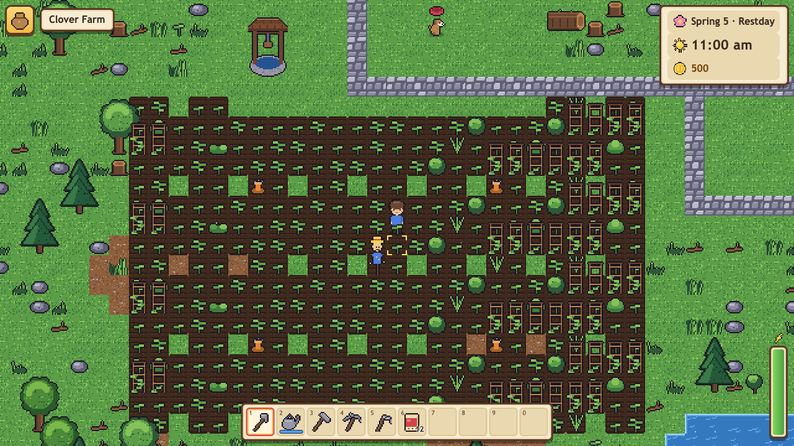
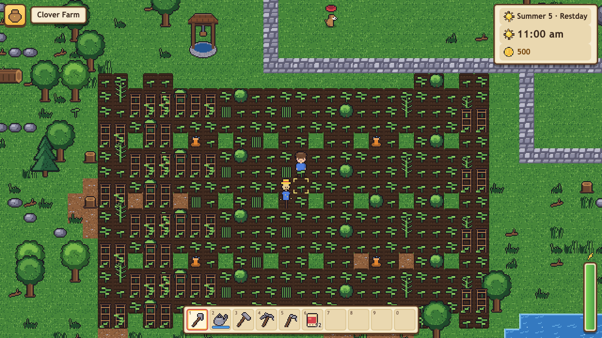
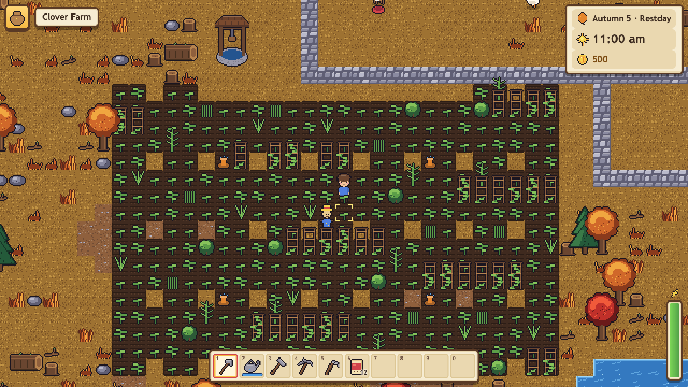
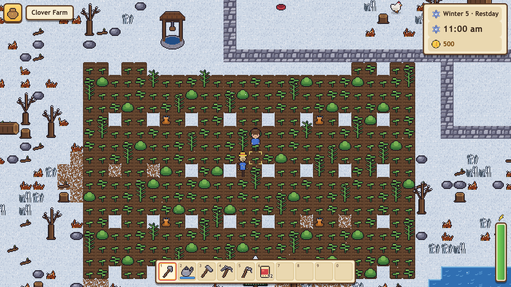
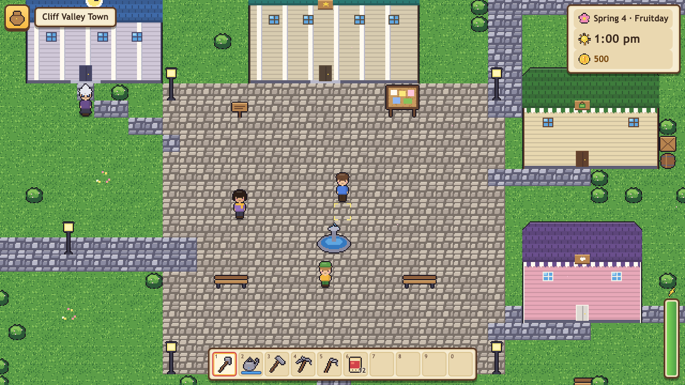
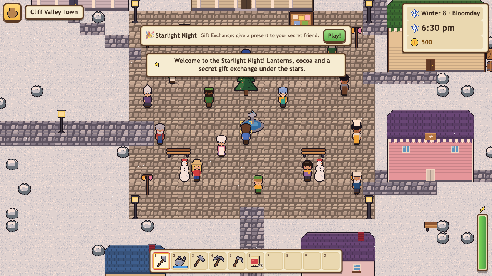
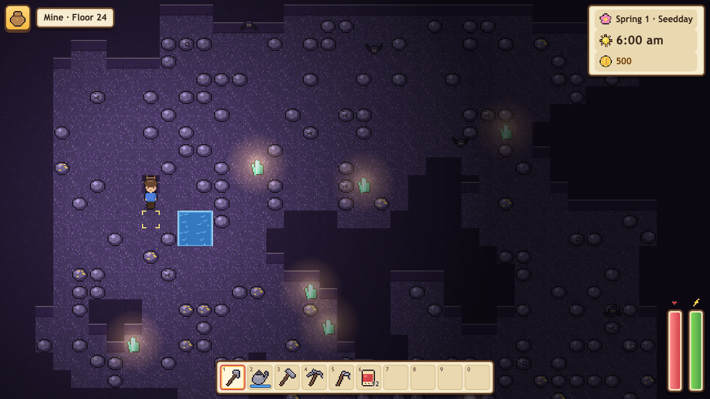
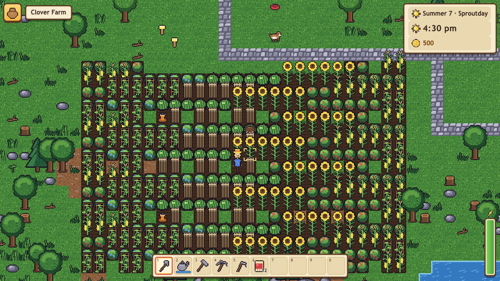
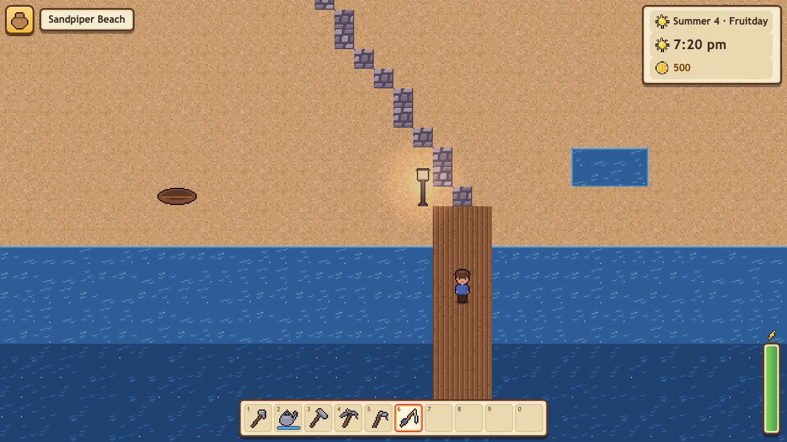

# Cliff Valley 🌱

A cozy 2D pixel-art farming life-sim for **ages 8–14**, made for **AI Kids Games**.

Great-Aunt Rosemary left you her old farm in Cliff Valley — but a big storm knocked the valley
about. Grow crops, raise animals, explore a 40-floor mine, fish, cook, craft and make friends
with 14 villagers. Fill the six restoration boards in the Valley Hall to fix the bridge, the
mine lift, the beach pier, the greenhouse and the valley train, find the Heartstone at the
bottom of the mine, and celebrate the Hall's grand reopening at the end of year one. After the
credits the farm keeps going, with year-two goals and a farm evaluation.

The whole game ships as **one self-contained `dist/index.html`** (≈1.1 MB): no network requests,
no ads, no purchases, no tracking, no chat, no external links. It works from `file://` and inside
a sandboxed iframe.



| | |
| --- | --- |
|  |  |
|  |  |
|  |  |
|  |  |

---

## How to play

- **Each day** starts at 6:00 am in your farmhouse and lasts about **12 real minutes** (the clock
  pauses in menus, dialogue, cutscenes and at festivals). Sleep in your bed to save and start a
  new day. Up past midnight you get sleepy; at 2:00 am you doze off and wake up at home — nothing
  is ever lost.
- **Year one** is four 10-day seasons (Spring, Summer, Autumn, Winter). Each season has a festival
  (Sprout Fair, Berry Bash, Harvest Show, Starlight Night) and villagers have birthdays on the
  calendar.
- **Farming:** clear weeds (scythe), rocks (pickaxe) and branches (axe), dig soil (hoe), plant
  seeds, water every day (rain does it for you), harvest, and put things in the **shipping bin**
  by your house — you're paid overnight. Sprinklers, scarecrows, fertilizer, fruit trees,
  tappers, giant crops and a greenhouse come later.
- **Animals:** ask Hollis the carpenter for a coop, barn and silo, then buy chickens, ducks,
  rabbits, cows, goats and sheep from the ranch. Pet them every day for better products.
- **Mine:** 40 floors in four layers. Break rocks to find the ladder down; the elevator stops
  every 5 floors. Cartoon critters just bounce away and poof into sparkles. If your health runs
  out, Lumi helps you home — nothing lost.
- **Fishing:** hold to cast, tap at the "!", then hold and let go to keep the marker in the green
  (the Tension Reel). 35 fish by place, season, weather and time. Crab pots catch things
  overnight.
- **Cooking & crafting:** 38 dishes (kitchen after the first house upgrade), 63 crafts, and
  machines (preserves jar, juicer, cheese press, loom, furnace, bee house, oil press, recycler,
  seed maker). Skills grow to level 10 with a perk choice at 5 and 10.
- **Friends:** chat every day and give gifts villagers like to grow hearts (up to 10, "best
  friends"); hearts unlock little friendship scenes, letters and recipes. No romance.
- **The story:** the Valley Hall boards ask for crops, forage, fish, animal goods, minerals and
  crafted goods — every bundle accepts *any K of N* options, so there's always another way.

## Controls

| | Keyboard & mouse | Gamepad | Touch |
| --- | --- | --- | --- |
| Move | WASD / arrow keys | Left stick / d-pad | Tap the ground (or the optional joystick) |
| Use tool / item | Space, C or left-click | A (hold to keep going) | Big yellow tool button, or tap a tile twice |
| Talk / pick up / open | E, X, Enter or right-click | B | Tap a villager or object, or the hand button |
| Pick a tool | 1–0, Q / R, or click a slot | LB / RB | Tap a toolbar slot |
| Aim at a tile | Mouse | Right stick | Tap the tile |
| Bag | I or Tab | X | Bag button (top left) |
| Map / Journal | M / J | Y | Menu tabs |
| Menu / back | Esc | Start / B | Close buttons |

Settings: music & sound volume, text size, read dialogue aloud (uses the device's voice if
available), gentle hints, reduced motion, screen shake, zoom, virtual joystick, left-handed
buttons, graphics quality, FPS display, and **Test performance**.

## Building and running

Requires Node 20.19+ (22 LTS or 24 recommended).

```bash
npm install
```

```bash
npm run dev
```

Opens the Vite dev server (port 5181, or the next free one).

```bash
npm run build
```

Typechecks, builds the single file `dist/index.html`, and checks it (≤ 2.5 MB, no external
scripts, stylesheets, fonts, workers or network APIs). Open it straight from disk or host it
anywhere.

| Command | What it does |
| --- | --- |
| `npm test` | Unit tests (growth, economy, schedules, friendship, machines, shops, save migration, content safety, …) |
| `npm run test:sim` | Headless **bot playthrough** from a new game to the year-one finale + the **pacing model** (writes `reports/pacing.md`) |
| `npm run test:e2e` | Playwright on desktop / tablet / phone: served, `file://`, and sandboxed iframe; no console errors or outside requests; saves survive reloads |
| `npm run pacing` | Just the pacing model |
| `npm run bench` | In-game benchmark on desktop/tablet/phone profiles (`-- --gpu` for real GPU, `-- --cpu=8` for heavier throttle) → `reports/bench.json` |
| `npm run capture` | Screenshots of every preview scene → `docs/screenshots/` (`-- --gpu --zoom=-2 --hud=0`) |
| `npm run analyze-playtests -- <folder or files>` | Summarize exported playtest logs → `reports/playtests.md` |

URL options: `?bench=1` (benchmark), `?playtest=1` (local playtest stats), `?lowq=1` (low
quality), `?seed=N`, `?scene=<name>&zoom=-2&hud=0` (preview scenes, never saved).

## AI Kids Games integration

1. `npm run build`
2. Copy `dist/index.html` to `public/games/cliff-valley/index.html` in the site.
3. Add the registry entry:

```ts
{
  slug: 'cliff-valley',
  title: 'Cliff Valley',
  tagline: 'Grow a farm, make friends and fix up a storm-tossed valley.',
  description:
    "Great-Aunt Rosemary's old farm is yours! Grow crops, raise animals, fish, cook, explore a 40-floor mine and help the villagers repair Cliff Valley after the big storm.",
  path: '/games/cliff-valley/index.html',
  categories: ['Cozy', 'Adventure'],
  ageGuidance: 'Ages 8–14',
  contentNotes: 'Farming and friendship, mild cartoon cave critters',
  controls: ['Keyboard and mouse', 'Gamepad', 'Touch'],
  devices: ['Computer', 'Tablet', 'Phone'],
  playTime: 'About 7–8 hours, plus endless farming',
  saves: 'Saves on this device (3 farm slots)',
}
```

**Storage** (all `localStorage`, all prefixed `cliffvalley.`, wrapped in try/catch with an
in-memory fallback when storage is blocked, e.g. in a sandboxed iframe):

| Key | What | Size |
| --- | --- | --- |
| `cliffvalley.slot.1` … `cliffvalley.slot.3` | Save slots (versioned, migrated, RLE-compressed farm tiles) | ≈ 8 KB for a new farm, ≈ 18 KB end of Spring, ≈ 32 KB at the year-one finale (budget 300 KB) |
| `cliffvalley.settings` | Settings | < 1 KB |
| `cliffvalley.playtest` | Only with `?playtest=1`: local playtest stats | a few KB – ~150 KB max (capped) |

Save sizes were measured from the bot's full year-one playthrough (seed 2026). A full storage
quota never corrupts a save: the write is checked and the old save is kept, with a friendly
message.

**Preview capture** (for the site's `npm run capture-previews`): every scene is a plain URL and
never touches the player's saves. Suggested size 1280×720.

| Preview | URL |
| --- | --- |
| Farm at harvest | `index.html?scene=farmHarvest&zoom=-2` |
| Festival (Starlight Night) | `index.html?scene=festival&zoom=-2` |
| Mine floor | `index.html?scene=mine&zoom=-2` |
| Fishing at sunset | `index.html?scene=fishingSunset&zoom=-2` |
| Town | `index.html?scene=town&zoom=-2` |
| Seasons | `index.html?scene=spring` · `summer` · `autumn` · `winter` (add `&zoom=-2`) |
| Title screen | `index.html?scene=title` |

Add `&hud=0` for a clean shot without the HUD. Scripts can also call
`window.__cliffvalley.scene(name)` (the read-only test hook; see `src/game/hook.ts`).

## Playtesting

Open the game with `?playtest=1`. A small **🧪 Playtest** badge appears; the game quietly counts
real play time (clock running vs. paused), each in-game day, bedtimes, milestones (first harvest,
boards, festivals, finale, faints) and FPS — **no names, nothing personal, never sent anywhere**.
Tap the badge to export: **Download file** (JSON) on a normal page, or the **Copy** box inside an
iframe. Put the exported files in a folder and run:

```bash
npm run analyze-playtests -- playtests/
```

It prints a Markdown summary (median minutes per in-game day, projected year-one hours vs. the
7–8 h target, bedtimes, progress, FPS) and writes `reports/playtests.md`. The `playtests/`
folder is git-ignored.

## Project layout

```
src/
  core/      rng (seeded), events, math, A* pathfinding, safe storage
  data/      ALL content: items, crops, villagers, dialogue, mail, cutscenes, festivals,
             shops, animals, minerals, fish, recipes, machines, skills, boards, achievements,
             maps (built with MapBuilder)
  sim/       headless game rules (no DOM/Pixi): Sim + GameState, world/locations, time,
             farming, economy, shops, npcs, friendship, mail, quests, animals, buildings, mine,
             critters, fishing, forage, crafting, machines, story, festivals, collections, save
  render/    PixiJS v8: pixel art authored in code → atlases, world view (chunked, culled,
             pooled), lighting, weather, effects
  game/      client glue: Game loop, controller, story/festival/mine/fishing UI, tips,
             bench, test hook, playtest recorder
  ui/        DOM UI: HUD, menus, dialogue, shops, inventory, settings
  audio/     Web Audio: synthesized sound effects + seeded chiptune composer
  input/     keyboard/mouse, touch, gamepad
  tuning.ts  every balance number in one place
tests/unit   Vitest unit tests        tests/sim   bot playthrough + pacing
tests/e2e    Playwright               scripts/    build check, bench, capture, playtest analysis
```

## Adding content

Everything is data-driven; art is generated from small "look" descriptions, so new content
usually needs no hand-drawn pixels.

**A crop** — add a line to `CROPS` in `src/data/crops.ts`:

```ts
c('turnip', 'Turnip', [0, 2], 'root', 'round', [0xe8d0e0, 0x9a5a8a, 0xffffff], 'A sweet purple-topped root.'),
```

then its numbers in `CROP_BALANCE` (`src/tuning.ts`): `turnip: { days: 5, seed: 25, sell: 55, xp: 9 }`
(add `regrow`, `yield` as needed). The seed packet, produce item, growth stages and icons are
generated; the store stocks it in its seasons automatically. Options: `trellis`, `giant`,
`fruit`, `leaf` color. Optionally add it to a board bundle (`src/data/boards.ts`) or a recipe.

**A villager** — add a `VillagerDef` to `src/data/villagers.ts` (look, home, birthday, loves/likes/
dislikes, schedule by map point names), a `DialogueSet` in `src/data/dialogue.ts`, and optionally
3/6/9-heart scenes in `src/data/cutscenes.ts` and letters in `src/data/mail.ts`. Portraits and
sprites come from the `look`. Unit tests check schedules are reachable, birthdays are unique and
dialogue is complete.

**A recipe** — dishes go in `DISHES` (`src/data/recipes.ts`) with ingredients (item ids,
`any:<group>` or `cat:<category>`), energy, price, an optional buff and a `look` for the icon; say
how it's learned in `COOK_LEARN`, `RADIO_RECIPES`, a letter's `attach.recipe` or a cutscene
reward. Crafts go in `CRAFTS` with a `learn` rule (`start`, `farming:3`, …).

**An event** — letters: add a `LetterDef` with a `when` (day, hearts or story flag) and optional
attachment. Friendship scenes: add a `CutsceneDef` (place, spot, hearts, time window, actors,
steps). Festivals: `src/data/festivals.ts` (+ minigame/decor in `src/game/festival.ts`). Story
scenes: `src/data/story-scenes.ts`. All text supports `{name}`, `{farm}` and `{pet}`; a unit test
scans every string for kid-safety (no romance, alcohol, gambling, scary words, links or
personal-info requests).

After balance changes, run `npm run test:sim` — the bot finds soft-locks (a board that can't be
finished, an unreachable floor) and re-measures pacing.

## Kid-friendly by design

No romance or dating (friendships and best friends), no alcohol or gambling (juice, jam, cheese;
a café), mild cartoon critters that bounce away, no harsh penalties (fainting or staying up late
just sends you home), no ads, purchases, tracking, external links, network requests or chat, and
the game never asks for personal information (the farmer's birthday is never asked; names are
nicknames that stay on the device).

## Continuous integration

Cliff Valley lives in the AI Kids Games monorepo. Its checks run in the root workflow
(`.github/workflows/ci.yml`, job **Cliff Valley**) on GitHub's standard runners for every pull
request and every push to `main` that touches `games/cliff-valley/` or shared files: typecheck,
unit tests, bot playthrough + pacing, the single-file build, and Playwright on desktop/tablet/phone
in low-quality mode with software WebGL. The real-GPU benchmark runs by hand on your own computer
(`docs/BENCHMARKS.md` at the repo root). Never connect a self-hosted runner to this public repository.

After changing the game, run `npm run import-game -- cliff-valley` at the repo root so the website
gets the new build; CI fails if the game's source changes without a re-import.
