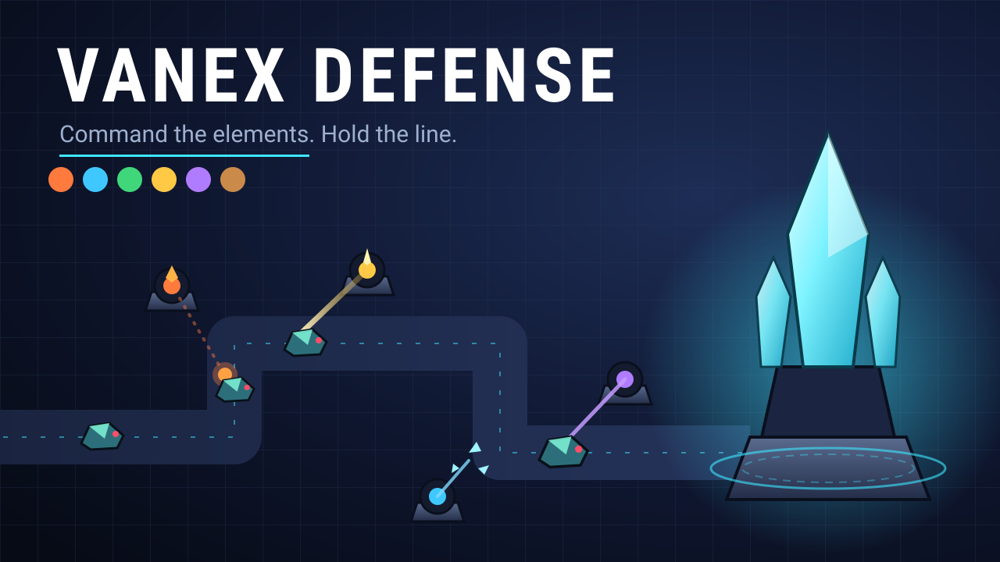

# Vanex Defense



An **elemental tower-defense strategy game for ages 10–14**, for phones, tablets and computers. You are the
Commander of the Vanex Defense Grid. The Shardbound — crystal constructs driven by a rogue rift engine and led by
Archon Null — are breaking through. Build and maze your towers, read each wave's intel, counter its elements,
specialize your best towers, field a commander hero and call down abilities. PIP, the grid's tactical AI, keeps
you briefed (and occasionally sarcastic).

- **6 worlds, 18 hand-made sectors** (Verdant Reach, Ember Wastes, Frostspire Peaks, Hollow Deep, Skyforge Ruins,
  Rift Citadel) with gates, drawbridges, sky lanes, twin citadels and shifting ground; 40 waves each
- **23 towers** (2 basic, 6 element, 15 combo), **42 specializations** at level 3, real stats everywhere (damage,
  attack speed, range, DPS)
- **17 constructs** with shields, barriers, stealth, tunnelling, tower jamming, regeneration and element wards;
  **4 multi-phase bosses** with telegraphed attacks
- **4 commander heroes** and **3 abilities**, a **research lab** paid with stars, **Story / Normal / Hard /
  Expert**, 5 **challenge medals** per sector, a **Daily challenge**, **Endless** with mutators, **38 badges**
- **Map Workshop:** build your own sector, bot-test it, share it as a code
- Adaptive soundtrack (per world + boss themes), English and Filipino, accessibility options
- 100% original and self-contained: every picture is drawn by code and every sound is synthesized — no asset
  files, no fonts, no ads, no purchases, no tracking, no network requests. Ships as **one `dist/index.html`**.

---

## How to play

1. **Choose an element.** You start with one element core; more arrive at waves 5, 10, 15, 20 and 25.
2. **Build towers** from the build bar. Bolt Turrets and Impact Cannons are always available; each element unlocks
   its tower, and any two elements unlock a **combo tower**.
3. **Maze.** On open sectors constructs walk *around* towers — make their route long (the arrows show it). You
   can't seal it completely; PIP will stop you.
4. **Read the intel.** The next-wave strip shows what is coming (counts, flyers, shields, bosses); tap it for the
   full breakdown. Call a wave early for bonus gold.
5. **Upgrade** to level 4. At level 3 every element and combo tower **specializes** into one of two paths.
   Selling refunds 75%.
6. **Command.** Move your hero, trigger its special, and use abilities (Crystal Meteor, Chrono Field, Emergency
   Funds) — research unlocks more heroes and abilities.
7. **Bank gold:** every cleared wave pays interest on unspent gold.

**The element wheel** — strong hits do 1.6× damage, weak hits 0.6×:

| | beats | because |
|---|---|---|
| 💧 Water | 🔥 Fire | Water quenches fire |
| 🔥 Fire | 🍃 Nature | Fire scorches nature |
| 🍃 Nature | 💧 Water | Nature drains water |
| ⭐ Light | 🌙 Shadow | Light pierces shadow |
| 🌙 Shadow | ⬢ Earth | Shadow erodes earth |
| ⬢ Earth | ⭐ Light | Earth blots out light |

Every element has its own **colour and shape**, so the game works for colour-blind players.
**Stars:** keep 80% of your lives for ★★★, 40% for ★★ — per difficulty. Stars open worlds and fund research.

## Controls

| Action | Touch | Mouse | Keyboard (default, remappable) |
|---|---|---|---|
| Choose a tower | tap a card (tap **Build** first on small screens) | click a card | `1`–`9`, `0` |
| Build | tap a square, then **✓** | click a square | — |
| Upgrade / sell / targeting | tap a tower → buttons | click a tower | `U` / `S` / `T` |
| Pick a specialization | tap a path in the panel | click | `1` / `2` |
| Commander: select / special | tap the hero button, then the map | click | `H` / `Q` |
| Abilities | tap an ability, then the map | click | `Z`, `X`, `C` |
| Wave intel / next wave | tap the next-wave strip / **Start** · **Call** | click | `I` / `N` or `Enter` |
| Speed 1× / 2× / 3× · pause | speed button · ❚❚ | same | `F` · `P` or `Space` |
| Learn about anything | press and hold | right-click / hold | — |
| Move / zoom the map | drag / pinch | drag / wheel | — |

Keys can be changed in Settings → Keyboard. The game pauses itself when the tab is hidden, the window loses focus
or the device rotates.

## Build & run

Requires Node 20+ (developed on Node 24, see `.nvmrc`).

```bash
npm install
```

```bash
npm run dev
```

```bash
npm run build
```

```bash
npm test
```

```bash
npm run e2e
```

| Command | What it does |
|---|---|
| `npm run dev` | dev server (http://localhost:5173) |
| `npm run build` | typecheck + single-file build → `dist/index.html` |
| `npm test` | Vitest: unit tests + headless balance sims (~40 s) |
| `npm run e2e` | build + Playwright: desktop, phones, tablet, sandboxed iframe, languages, accessibility, flash audit |
| `npm run check:dist` | size budget + file:// and http smoke check, zero network requests |
| `npm run sim [-- w2m1 hard] [-- --casual]` | autoplay bot over maps × difficulties |
| `npm run balance-report` | full bot report → `docs/reports/balance.md` |
| `npm run perf` | frame-time benchmark on throttled phone / tablet profiles → `perf-results/` |
| `npm run audio:levels [-- --write]` | mixing pass: loudness of every track / sound → `src/audio/mix.ts` |
| `npm run analyze-playtests -- <folder>` | playtest exports → tuning suggestions (never applied) |

`dist/index.html` works when double-clicked (file://), on any static host, or inside a sandboxed iframe.

**URL flags:** `?map=w2m1&diff=hard` (jump into a sector), `?map=w1m1&endless`, `?seed=42`, `?lang=en|fil`,
`?stress=300[&map=w6m3]` (stress test with an FPS meter — works in the production build too),
`?quality=low|medium|high|auto`, `?playtest=1|0`. Dev server only: `?editor=1`, `?gallery=1`.

## Putting it on AI Kids Games

1. `npm run build`
2. Copy `dist/index.html` → `public/games/vanex-defense/index.html`
3. Copy `marketing/banner-16x9.svg` → `public/games/vanex-defense/banner.svg` and
   `marketing/thumbnail-square.svg` → `public/games/vanex-defense/thumbnail.svg`. **Recapture the site
   previews:** both images are new for this version (crystal-tech look), so any cached or pre-rendered preview
   images, social cards or screenshots of the old Vanex Defense on the site should be regenerated
   (`node scripts/render-svg.mjs <out-dir>` writes PNG versions of both).
4. Embed it (add `allow="fullscreen"` so the Full screen button works; it hides itself otherwise):

```html
<iframe
  src="/games/vanex-defense/index.html"
  sandbox="allow-scripts allow-pointer-lock allow-same-origin"
  allow="fullscreen; autoplay"
  style="width:100%;aspect-ratio:16/9;border:0"
  title="Vanex Defense"
></iframe>
```

5. Registry entry for `games.ts` (adjust key names to match your `Game` type if they differ):

```ts
{
  slug: 'vanex-defense',
  title: 'Vanex Defense',
  description:
    'Command an elemental defense grid: build and maze towers, counter each wave’s elements, specialize, field a hero and hold the line across six worlds — or build your own map.',
  path: '/games/vanex-defense/index.html',
  thumbnail: '/games/vanex-defense/thumbnail.svg',
  banner: '/games/vanex-defense/banner.svg',
  categories: ['Strategy'],
  ageGuidance: 'Ages 10–14',
  contentNotes: 'Sci-fi fantasy battles against crystal robots: towers fire energy beams and constructs shatter into crystal shards. No blood, gore or scary horror. No ads, purchases, chat or accounts.',
  controls: ['touch', 'mouse', 'keyboard'],
  devices: ['phone', 'tablet', 'computer'],
  languages: ['en', 'fil'],
  estimatedPlayTime: '15–25 minutes per sector (8–12 hours for the full campaign; Endless, Daily and the Workshop are open-ended)',
  orientation: 'landscape', // portrait works; landscape is roomier on phones
},
```

**Storage** (all `localStorage`, all keys prefixed `vanex-defense-`):

| Key | When | Size |
|---|---|---|
| `vanex-defense-save` | always (versioned, v4, with migrations; progress from v1 carries over) | ~2–5 KB typical, < 50 KB worst case (tested) |
| `vanex-defense-save-backup` | written once when an older save is upgraded | the size of the old save (~2 KB) |
| `vanex-defense-playtest` | only with `?playtest=1` | ≤ 60 KB (oldest runs dropped) |

Worst case total stays far below the 200 KB budget this game has on the shared site. If storage is blocked the
game still runs and simply forgets progress when the page closes. **Build size:** `dist/index.html` ≈ 1.1 MB
(≈ 335 KB gzip), budget 2 MB (enforced by `npm run check:dist`).

## Project structure

```
src/
  core/      seeded RNG (sfc32), pools, math
  data/      content as data: tuning.ts (EVERY balance number), elements, towers (+ specs), enemies, waves,
             difficulty, heroes, research, modes (daily), workshop codes, maps/, worlds, achievements
  sim/       headless game logic (no DOM/Pixi): Game, grid, flowField (teleport edges), hero, spatial hash,
             entities, events, autoplay bot, workshop checks
  render/    Pixi: Stage, WorldView, Camera, MapPainter, Particles, FloatingText, flash safety, quality governor,
             atlas/ (procedural art)
  ui/        DOM HUD + menus (Hud, modals, styles.css)
  app/       App, GameScreen, flow (navigation), tutorial, achievements, save, a11y, hotkeys, playtest, perfTest,
             screens/ (title, sector map, codex, research, daily, workshop, settings, …)
  audio/     Web Audio synth voices, adaptive music, SFX + stingers, generated mix gains
  i18n/      t() + plurals, en.ts (source), fil.ts (Filipino draft), pseudo-locale
  dev/       dev-only map editor & sprite gallery (tree-shaken from the production build)
tests/unit/  Vitest (pathfinding, combat, mechanics, heroes, saves, i18n, audio, a11y, playtest, maps, balance/)
tests/e2e/   Playwright (smoke, embed, i18n overflow, accessibility, flash audit, device tools)
scripts/     simulate, balance-report, perf, audio-levels, analyze-playtests, check-dist, review-shots, shot, …
docs/        style guide, CI setup, reports/, screenshots/ (before / slice / after)
marketing/   banner-16x9.svg, thumbnail-square.svg
```

The simulation runs at a fixed 30 Hz and is completely separate from rendering, so it is unit-tested and
balance-tested headlessly. The renderer interpolates between ticks and turns sim events into particles, text
and sound.

## Adding content

### A new map

1. Design it with the dev editor (`npm run dev`, open `http://localhost:5173/?editor=1`, paint, **Play test**,
   **Copy ASCII**) or in the in-game Map Workshop.
2. Add a `MapDef` to `src/data/maps/worldN.ts`:

```ts
{
  id: 'w2m4', world: 2, theme: 'desert', style: 'maze', // name + story live in src/i18n/en.ts (map.w2m4.*)
  favoredElements: ['fire', 'earth'], // creature elements that appear more often
  grid: [ /* rows of the legend below */ ],
}
```

Legend: see `src/data/maps/types.ts` (`.` open ground · `o` build spot · `=` road · `#` rock · `T`/`B` scenery ·
`~` water · `S` spawn · `C` citadel 2×2, plus gates `P`/`Q`, bridges `H`/`h`, sky lane `Y`/`F`, unstable `U` /
rubble `R`). Keep rows the same width. Add `map.<id>.name` and `map.<id>.story` to `en.ts` **and** `fil.ts`.

3. `npm test` validates every map (castle, reachable spawns, room to build) and **proves it is winnable** on all
   difficulties with the autoplay bot. `npm run sim -- w2m4` shows details.

### A new tower

Identity (look, behaviour, text keys) goes in `src/data/towers.ts`, numbers in `TUNING.towers` /
`TUNING.specs` in `src/data/tuning.ts` — stats for 4 levels via `makeLevels`, a `behavior`
(`bullet`, `chain`, `beam`, `pulse`, `mortar`) and a `look` (silhouette + colours for the procedural painter).
Abilities are data: `splash`, `slow`, `burnDps`, `poisonDps`/`poisonSpread`, `stunChance`, `armorBreak`,
`pushback`, `zoneDps`, `auraRate`, `auraCoins`, `beamRamp`, `shots`, `chain`, `critChance`… If you need a
brand-new attack style, add one behaviour function in `src/sim/Game.ts` (`updateTowers`) and, if it needs a new
silhouette, one case in `src/render/atlas/drawTowers.ts`. Combo towers are found automatically from their two
`elements`. Tests check every tower can hit creatures.

### A new creature

Identity in `src/data/enemies.ts`, numbers in `TUNING.enemies` (health, speed, armor, gold, and optional
`flying`, `heal`, `split`, barrier, cloak, burrow, disable, regen…), wave use in `src/data/waves.ts` /
`TUNING.waves.mechanics`. Its sprite comes from one of the `look` painters in
`src/render/atlas/drawEnemies.ts`. Text: `enemy.<id>.name/blurb/tip` in both language files.

## Performance

`npm run perf` (`?stress=300`: every tower type, 300 constructs, ~440 projectiles, ~1,400 particles, plus the hero
special and meteor / chrono abilities firing) on the production build with CPU throttling; results in
`perf-results/perf.json`. Measured 2026-10-11 on an M3 Pro **while other projects kept the machine busy**
(load average 30–45), so treat these as lower bounds and re-run on an idle machine ([docs/BENCHMARKS.md](../../docs/BENCHMARKS.md) at the repo root):

| Profile | v2 FPS | p95 frame | sim / draw per frame | v1 at the same time |
|---|---|---|---|---|
| Phone, 4× CPU throttle (≈ mid-range Android) | 54–58 | 33 ms | 2.2 / 6.4 ms | 53–57 fps, 1.6 / 5.6 ms |
| Phone, 6× CPU throttle (low-end), heaviest map w6m3 | 36 (Auto → Low, 0.75× res) | 33 ms | 4.5 / 8.8 ms | — |
| Tablet, 2× CPU throttle | 60 | 16.8 ms | 0.6 / 2.3 ms | — |
| Desktop | 60 | 16.7 ms | 0.4 / 1.2 ms | — |

Texture memory: atlases 48 MB with mipmaps on High / Medium (29 MB on Low) + ~12 MB terrain ≈ 60 MB, inside the
~64 MB budget. How: fixed-timestep sim, Pixi render groups, sprites baked once into texture atlases,
`ParticleContainer` particles, pooled everything (no allocations in the frame loop), spatial hash targeting,
pathfinding only when towers change, a 60 FPS cap, a stopped renderer in menus, and an FPS governor that lowers
resolution, then particles/glow, on slow devices. Players can measure their own device in **Settings → Device →
Test performance**.

## Continuous integration

The AI Kids Games monorepo's root workflow checks every pull request and push on Ubuntu (typecheck, unit tests +
balance sims, build, dist checks, all Playwright tests). The real-GPU benchmark runs by hand on your own computer.
Details: [docs/CI.md](docs/CI.md).

## Testing on real devices

- **Settings → Device → Test performance** runs a 15-second battle (every tower, 300 constructs) with the player's
  own quality setting and shows average fps, the slowest 1 %, the longest frame, quality tier, renderer and screen.
  "Copy results" puts a plain-text summary on the clipboard.
- **Playtest mode:** open the game once with `?playtest=1` (e.g. `index.html?playtest=1`); it stays on for that
  device until "Stop recording" (or `?playtest=0`). Each match (won, lost or abandoned) records map, difficulty,
  waves, lives, lives lost per wave, towers, specializations, abilities, game speed, pauses, frame rate, quality
  tier and screen size — in `localStorage` key `vanex-defense-playtest`, capped at ~60 KB (oldest runs drop off).
  **Nothing personal is recorded, and nothing is ever sent anywhere.** The title screen's "Playtest · N runs"
  button shows the data: *Download JSON* (standalone page) or copy the text (always works, also inside the site's
  iframe), *Delete recorded runs*, *Stop recording*.
- **Analyse:** put the exported `.json` files in a folder and run `npm run analyze-playtests -- <folder>`. It prints
  win rates, where losses cluster, lives lost per wave, speed use and frame rate per map/difficulty and device,
  replays the same maps with the good and casual bots, and lists tuning **suggestions** — it never changes any
  file. Apply a suggestion in `src/data/tuning.ts`, then run `npm run sim` and `npm test`.
- If the GPU context is lost (driver reset, memory pressure), the match pauses with "Graphics paused" and continues
  after one tap when graphics return; if they never do, a Reload button appears (progress is saved).

## Kid-safety & accessibility

Made for ages 10–14: no ads, purchases, accounts, chat, links, tracking or network requests. Constructs are
crystal robots that shatter into shards — no blood, gore or horror; text is short and middle-school level. Colour + shape for every element, 48 px+ touch targets, safe-area aware layout, separate music
and sound volumes, optional screen shake and damage numbers.

Settings → Accessibility: **text size** (100 / 115 / 130 %), **high contrast**, and **reduced motion** (defaults to
the device's setting; turns off shake, wobble and hit flashes and softens big bursts). Settings → Keyboard:
**remappable keys** (conflicts swap; Esc, Space and Enter always work). **Flash safety** is always on: nothing on
screen flashes more than 3 times a second (WCAG 2.3.1) — enforced in code and measured on real rendered frames by
`tests/e2e/flash.spec.ts`.

## Languages

English (source, `src/i18n/en.ts`) and Filipino (`src/i18n/fil.ts`). Settings → Language defaults to the device
language (`fil`/`tl` → Filipino, anything else → English) and can be changed at any time; the choice is saved.
Dev builds also offer a pseudo-locale (accented, ~40 % longer) for layout testing; `?lang=en|fil|pseudo` forces
a language. `npx playwright test tests/e2e/i18n.spec.ts` checks every menu, modal and the battle HUD in all three
on desktop and phones for clipped, cut-off, covered or untranslated text.

### Translations needing review

| Language | Strings | Status |
|---|---|---|
| Filipino (`fil`) | all 1,010 | **Needs native review** — machine-assisted first draft (`FIL_REVIEW_STATUS = 'needs-native-review'`). Players see a short note under Settings → Language while this is set. |

Notes for the reviewer (open `src/i18n/fil.ts`; keys and `{placeholders}` must stay as in `en.ts`, `npm test` checks):
- Proper nouns stay in English on purpose: tower, construct, hero, ability, specialization, world, map and
  research names, PIP, Vanex, Archon Null, the Shardbound, and the Map Workshop name word lists.
- Glossary used: tore (tower), konstruk (construct), alon (wave), ginto (gold), buhay (lives), Kuta (Citadel),
  core ng elemento, panangga (elemental ward), kalasag (shield), harang (barrier), bayani (hero), kakayahan
  (ability), pananaliksik (research), tsapa (badge), landas (specialization path), Kuwento / Normal / Mahirap /
  Eksperto (difficulties). "Rift", "boss", "upgrade", "combo", "DPS", "Intel" are kept as gamer Taglish.
- Register: UI and tips use informal *mo*; some PIP briefings to the Komandante use polite *ninyo/inyo* — please
  pick one voice for PIP.
- Worth a second look: `badge.king.name` (pun on "null and void"), `boss.*` phase names, `hero.*.role`,
  `trait.disabler` ("Pampatigil"), `map.w6m3.story` ("alingawngaw"), the longer button labels
  (`pause.restart`, `daily.play`, `ability.cancel`, `settings.q.medium`, `title.research`).
- When done, set `FIL_REVIEW_STATUS` to `'reviewed'` (removes the in-game note).

## Credits

Game design, code, art and music: all original, generated in code for this project.
Built with [PixiJS](https://pixijs.com), Vite, TypeScript, Vitest and Playwright.
